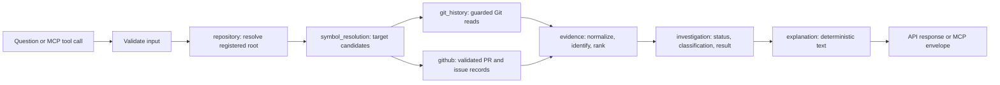

# Design Document: Evidence Retrieval (Native Spec)

## Overview

This design realizes the Evidence Retrieval requirements in the existing backend modular monolith. It uses only the modules, dependencies, and services that the Architecture already names, and it adds none. The HTTP API and the MCP adapter are two entry points to the same chain of module functions, so retrieval, ranking, classification, and explanation exist once and work without an AI provider.

The sections below follow the Kiro design layout. The original section titles are kept as sub-headings, so existing references to them remain valid. Open decisions are listed at the end and are not treated as settled.

### Sources and authority

- Requirements: `requirements.md` in this folder, derived from #[[file:docs/specs/spec-1-evidence-retrieval.md]].
- Module boundaries: #[[file:docs/architecture/architecture-and-project-setup.md]] §5, §7, §12, §14, §18, and §25.
- MCP contract proposal: #[[file:docs/development/d02-mcp-integration-decision-record.md]] §16. That section is a proposal for review. It is not approved.
- Dependencies and versions: #[[file:docs/development/d01-dependency-decision-record.md]].
- Shared HTTP contract: defined once, in "Shared integration contract (canonical)" below. The Ouija Experience design references that section and defines no contract fields.
- Repository registration: decided in "Repository registration and selection" below (owner decision E-D1, closed).
- This design adds no module, dependency, or service beyond those the Architecture already names. Where a design choice is not established by an approved document, it is listed under "Open decisions" and is not treated as settled.

### Design principles

1. **One backend, one implementation.** The HTTP API and the MCP adapter call the same functions in the same backend modules (Architecture §5, §12). No retrieval, ranking, or classification logic exists in `mcp`.
2. **Evidence first.** Every value in a result traces to a retrieved source record. Missing values stay missing (Spec 1 §8).
3. **Three separate concepts.** Retrieval status, epistemic classification, and conclusion are separate fields. No function maps one onto another (Spec 1 §10).
4. **Read-only repositories.** Only read operations reach Git, and only through a single guarded runner (Spec 1 §13).
5. **Deterministic core.** Retrieval, ranking, classification, and explanation work without AI (Spec 1 §11.1).

## Architecture

The backend is one application with the modules below (Architecture §7, Spec 1 §16). The HTTP API (`api`) and the MCP adapter (`mcp`) call the same functions. Neither adds a step to the chain.

### Module responsibilities

The module names come from Architecture §7 and Spec 1 §16.

| Module | Responsibility | Depends on | Requirements |
|---|---|---|---|
| `core` | Configuration, logging, shared error types, the guarded subprocess runner for Git. | none | 15, 18, 19 |
| `repository` | Registration and selection, repository namespace, root path, resolved-path containment. | `core` | 1, 14 |
| `symbol_resolution` | Path normalization, symbol and code-region resolution, ambiguity candidates. | `repository`, `core` | 2 |
| `git_history` | Read-only Git retrieval: log, blame, history of a path or symbol, and revision resolution. | `repository`, `core` | 3, 14, 15 |
| `github` | PR and issue metadata, identity validation, rate limits, and response bounds. | `core` | 5, 16 |
| `evidence` | Evidence model, provenance, identity, normalization, deduplication, and ranking. | none | 4, 6 |
| `investigation` | Orchestration, retrieval status, epistemic classification, result assembly, consistency checks. | `symbol_resolution`, `git_history`, `github`, `evidence` | 7, 8, 9, 12 |
| `explanation` | Deterministic explanation from verified fields; optional AI wording behind configuration. | `investigation` | 10, 11 |
| `api` | HTTP routes and transport. Calls `investigation` and `explanation` only. | `investigation`, `explanation` | 9 |
| `mcp` | STDIO entry point and four tool adapters. Calls the same functions as `api`. | `investigation`, `github`, `git_history`, `repository` | 13 |

Persistence and the SQLite cache are implementation concerns of `github` and of the module that needs them. They are not a separate module (Architecture §7, Spec 1 §16).

### Data flow

Each arrow carries only validated data. `api` and `mcp` are two entry points to the same chain. Neither adds a step.

### Repository and path containment

- A registered repository has one root. Every path, revision, and Git call is resolved inside that root (Requirements 1.4 and 14).
- Containment compares resolved paths. Symbolic links and Windows junctions that leave the root are rejected (Requirement 14.3).
- Windows path forms are rejected at input: drive letters, UNC paths, alternate data stream syntax, reserved device names, and trailing dots or spaces (D02 §16.6).
- No MCP input supplies a repository location. The caller passes `repository_id` only, and that value is matched against the registered set (D02 §16.0).

### Persistence and local data

- SQLite stores the cache. Its file lives under `%LOCALAPPDATA%\Sean\` by default (Architecture §8, A11).
- Cache entries carry the repository namespace and source identity. Invalidation rules are defined in D06, which is open.
- The cache is optional. Core Git retrieval works when it is absent or corrupted (Requirement 17.4).

## Components and Interfaces

These sections describe the behavior and interfaces of the components named above: Git retrieval, repository registration, GitHub retrieval, ranking, explanation, the API and MCP entry points, and the shared HTTP integration contract. The fields of the HTTP exchange are defined once, in the canonical contract.

### Git retrieval design

- **Single runner.** All Git calls go through one function in `core` that takes an argument array, an explicit working directory, a controlled environment, a timeout, and a byte limit. No shell is used (Requirement 15).
- **Allowlist.** Only read subcommands the retrieval needs are reachable. Input values are never placed in an option position. Values that start with `-` are rejected.
- **Repository configuration is untrusted.** The runner passes the options that disable external diff, textconv, and fsmonitor for each call, and it never runs fetch, write, or hook-triggering operations. The exact option set is checked against the installed Git at implementation time (D02 §16.9 item 4; Requirement 15.4). The option list is a decision to verify, not an assumed fact.
- **Revisions.** A revision input is validated as a commit name and resolved by Git to a commit inside the selected repository. Expressions are rejected for the MVP (D02 §16.0 and §16.6, DEC-14).
- **Shallow clones.** Detected before retrieval. A shallow clone adds a `SHALLOW_CLONE` limitation and caps the retrieval status at `PARTIAL` (Requirement 3.2).

### Repository registration and selection

**Decision (owner, Phase 2 closure; E-D1, E-D7, DEC-3).** Repositories are registered in a local JSON configuration file that the backend reads at startup. Nothing else registers them. Registration does not use SQLite.

- **Who registers.** The owner edits the configuration. No HTTP route, MCP tool, or UI action registers, changes, or removes a repository (Spec 1 §22 "local repository selection"; Requirement 1.4).
- **Where the registry lives.** `%LOCALAPPDATA%\Sean\config\repositories.json`, outside any repository (Architecture §8). The file name is fixed at task 1.1. Sean reads this file and does not write it. Other local data locations remain under D07.
- **Schema.** A top-level object with `schema_version` (integer, currently `1`) and `repositories` (array). Each entry has:
  - `repository_id`: string, unique, chosen by the owner and not derived from the path, so it survives a move.
  - `root`: absolute local path to the Git work tree.
  - `github`: optional object `{ "owner": string, "name": string }`. Omitted when the repository has no GitHub mapping. GitHub calls for that repository then return `GITHUB_IDENTITY_UNRESOLVED` (D02 §16.8).
  Unknown keys are rejected. The file never contains tokens or other secrets (Requirement 18).
- **Startup validation.** `repository_id` is unique and matches the format chosen at implementation. The root exists, is a directory, and is a Git work tree. An invalid entry is excluded and reported through observability (Requirement 19). Other entries keep working. A missing, unreadable, or unsupported-version file leaves zero repositories registered and reports the cause. Sean does not fall back to another registry source.
- **Resolution at each call.** The `repository` module provides one function. Given `repository_id`, it returns the resolved root and the GitHub identity. Both HTTP and MCP call it (D02 §16.10). An unknown `repository_id` returns `REPOSITORY_NOT_FOUND`. A root that is no longer valid at call time returns `REPOSITORY_UNAVAILABLE`. The root is resolved again at each call, and containment is checked against that resolved root.
- **Shared path rules.** The path rules in canonical C.3a are implemented once, in `repository`. HTTP and MCP both call them, so the two interfaces cannot disagree.
- **Selection in the interface.** The user picks a repository from the registered list. The selection sends `repository_id` only (Ouija O-D3).
- **Several repositories.** Allowed. Each investigation uses exactly one.
- **Out of scope.** Scanning folders to discover repositories, creating or relocating repositories, and any write to a repository (Spec 1 §13).

### GitHub design

- The owner and name are recorded explicitly in the registry entry (`github`). They are never derived from a Git remote, so no remote-selection rule exists (DEC-4, closed).
- A PR or issue is returned only if the response belongs to that repository. Owner and name are compared case-insensitively. A mismatch returns `GITHUB_IDENTITY_MISMATCH` (D02 §16.0).
- Exact GitHub REST field names are confirmed at implementation time against the API version in use.
- Requests use a timeout, a response-size bound, and rate-limit handling. Redirects to other hosts are not followed (Requirement 16). The request limits are configuration values (DEC-10).
- Unavailable records are reported as retrieval limitations, not as proof of absence (Requirement 5.4).

### Ranking design

- Ranking uses the criteria and initial weights in Spec 1 §9.
- Weights are configuration, not constants. Calibration against the Golden Test Suite (D05) is required before they are treated as validated.
- Each ranked item stores its score and per-criterion awards, so the ranking can be explained (Requirement 6.4).
- Ties are broken by a fixed rule on evidence identifier (Requirement 6.2). Within one result, records are ordered by score descending, then by `evidence_id` ascending using ordinal UTF-8 byte comparison, with no locale collation and no case folding.

### Explanation design

- The default explanation is built from templates over verified fields. Each template states what the evidence establishes, what can be inferred, and what remains unknown (Spec 1 §11.1).
- Optional AI wording is deferred by owner decision (2026-11-10; E-D13 decision record). The provider (Google Gemini API, Free Tier) and model (`gemini-3.6-flash`) were approved on 2026-11-10 and are not implemented. The deterministic explanation is the only active explanation engine. Any future provider design must define its input (verified fields only), its output checks (Requirement 11.2), and the privacy gate (E-D13 AI-3). No provider interface is added without a concrete requirement (Architecture §2.7 and §7).

### API and MCP

- `api` and `mcp` expose the same operations. Their request and result types live in the owning modules, so `api` never imports from `mcp` (D02 §16.10).
- The four MCP tools are `search_history`, `blame_range`, `get_pr`, and `get_issue` (Spec 1 §12). No other tool is added.
- **Separation of evidence retrieval and classification (E-D3, resolved by interpretation).** The MCP retrieval tools return ranked evidence with provenance and a retrieval status (Spec 1 §12). They return no epistemic classification and no conclusion. Spec 1 §10.3 defines the investigation result, which includes classification and conclusion. Investigation orchestration (the `investigation` module) builds that result from the same evidence, and only the HTTP investigation contract carries it. Rationale: §12 names four evidence tools and no investigation tool. Forcing every retrieval tool to run a full investigation would also make `blame_range` and `get_pr` return conclusions they cannot support. Spec 1 FR-10 says "approved investigation capabilities", which can be read more broadly than the §12 list. That wording is an owner decision (C-D6). This design does not edit the source document.
- The HTTP investigation exchange is defined by the canonical contract below. Route names, status codes, and request field names are closed owner decisions (C-D1, C-D4). The `investigation_id` format (C-D5) is a UUID version 4 string, decided and recorded at task 15.1.
- **Owner decision recorded (DEC-13).** The owner decided to keep `.kiro/settings/mcp.json` unchanged until the MCP module is implemented, and then to validate or correct its launch configuration as part of that implementation. Status in Phase 2: the file is present and unchanged. Its entry names `app.modules.mcp`, which does not exist. The production MCP server is not functional. Nothing in Phase 2 may start or test the nonexistent module. Architecture §12.2 says not to configure the entry point before it exists, so the file is an accepted, documented deviation from that rule. The owner accepted it in the Phase 2 closure task, and D02 DEC-13 records the acceptance. Validation or correction is task 17.5. Runtime enablement waits for D02 closure (C-D7). The conventional MCP approach remains in force, and Kiro Powers are not part of Sean. This design does not edit the file.
- Launch expectations for the future module: interpreter `backend/.venv/Scripts/python.exe`, module `app.modules.mcp`, and module search path `backend`. The `-P` flag stays open until T12 (DEC-8).

### Shared integration contract (canonical)

This section is the only definition of the HTTP investigation exchange. The Ouija Experience design and tasks reference it and define no contract fields. Changing a field here comes first, and the Ouija design follows. This section is a design. No code is written from it until the owner approves task 15.1.

Sources: Spec 1 §8, §10.3, §10.4, §22; Spec 2 §8.3 to §8.5, §18.1 to §18.7, §8.7, §12.1; D02 §16.5 for proposed error codes.

#### C.1 Scope and persistence

- Covers one investigation request and its response, through `api`.
- Does not cover the four MCP tools. Their responses are the evidence envelopes in D02 §16.5. They carry evidence and retrieval status only.
- No approved document requires a store of past investigation results, and this contract defines none. Each response is produced on request. `investigation_id` identifies that response. Cache rules belong to E-D6.

#### C.2 Value domains, kept separate

| Domain | Values | Set by | Appears in response | Meaning |
|---|---|---|---|---|
| Retrieval status | `COMPLETE`, `PARTIAL`, `INSUFFICIENT`, `FAILED` | Backend | Always | How the retrieval went (Spec 1 §10.2). |
| Epistemic classification | `DOCUMENTED`, `INFERRED`, `PARTIAL_EVIDENCE`, `INSUFFICIENT_EVIDENCE` | Backend `investigation` module | Only when classified | What the evidence supports (Spec 1 §10.1). |
| Conclusion | text | Backend | Only when supported | The reconstructed answer (Spec 1 §10.3). |
| Lifecycle state | `IDLE` to `CANCELLED` | Frontend only | Never | The user's flow (Spec 2 §8.2). |
| Presentation state | `COMPLETED`, `PARTIAL`, `INSUFFICIENT_EVIDENCE`, `FAILED` | Frontend, derived by Spec 2 §8.5 | Never | What the board shows. |

The names `PARTIAL` and `FAILED` appear in two domains. In the backend they are retrieval statuses. In the frontend they are presentation states. A consumer must never treat one as the other. The frontend stores the backend value unchanged and derives the presentation state separately (Spec 2 §8.5, §17.4). Presentation state `COMPLETED` means retrieval status `COMPLETE` with classification `DOCUMENTED` or `INFERRED`. It does not mean that every historical source was found (Spec 1 §10.2).

#### C.3 Request

| Field | Type | Required | Rule |
|---|---|---|---|
| `repository_id` | string | yes | Namespace of a registered repository (see Repository registration and selection). |
| `target.path` | string | yes | Repository-relative path under the rules in C.3a. An invalid path is a category B error (C.5). |
| `target.symbol` | string | no | 1 to 256 characters, no control characters or newlines. |
| `target.line_start`, `target.line_end` | integer | no | Both or neither. Start at most end. |
| `question` | string | yes | Shown with the result. Not interpreted by the backend (C-D1). Length bound from configuration (DEC-10, E-D14). |

- The backend rejects unknown fields. A client never sends `retrieval_status`, `epistemic_classification`, `conclusion`, or any other backend value.
- No revision field is defined for investigations. Blame revisions belong to the `blame_range` MCP tool only (DEC-14). Adding one here would add a capability no approved document asks for.

#### C.3a Repository-relative paths

These rules apply to `target.path` in every investigation request. The same rules apply to MCP path inputs (D02 §16.6). The `repository` module implements them once. HTTP and MCP both call that function.

1. **Form.** A non-empty string. Backslashes and forward slashes are both accepted and normalized to forward slashes. The length bound comes from configuration (DEC-10, E-D14).
2. **Lexical rejection (category B, `INVALID_INPUT`, `field: target.path`).** Reject absolute paths (a leading `/` or `\`), drive-qualified paths (`C:`), UNC and device-namespace prefixes (`\\`, `\\?\`, `\\.\`), any `..` segment after normalization, NUL and other control characters, any colon, which covers alternate data streams and drive syntax, Windows reserved device names with or without an extension, and segments that end in a dot or a space.
3. **Root.** The root is the resolved root from the registry, resolved again at each call (see "Repository registration and selection"). A client never supplies a root.
4. **Resolution (category B, `PATH_OUTSIDE_REPOSITORY`).** The path is joined to the resolved root. Each existing component is resolved with the platform's real-path function, which handles symbolic links and Windows junctions. If the result lies outside the resolved root, the path is rejected. The comparison works by path segments, not by string prefix, so a sibling such as `root-other` does not match `root`.
5. **Historical paths.** A path may name a file that is absent from the current working tree (Spec 1 §5 and §6). For such a path, containment is checked on the lexical join and on the resolved longest existing ancestor. A symbolic link or junction on an existing ancestor that leads outside the root is rejected.
6. **No disclosure.** A rejection never states whether the path exists outside the root.
7. **Never successful.** A path that fails any step is not used for retrieval and never produces a category A result.

Junction and reparse-point handling of the platform real-path function must be checked on Windows in task 2.1 before the rule is relied on (Spec 1 §23.17).

#### C.4 Response: investigation result

| Field | Presence | Meaning |
|---|---|---|
| `investigation_id` | always | UUID version 4 string (C-D5), server-generated, unique per response. |
| `question` | always | Echo of the request question. |
| `repository` | always | `{ repository_id }`. |
| `target` | always | `resolution` (`RESOLVED` or `UNRESOLVED`), `path`, `symbol`, and `line_range`. An ambiguous target never produces a result. It is the category B error `TARGET_AMBIGUOUS` (C.10), so an ambiguous target is never resolved silently (Spec 1 §5). |
| `retrieval_status` | always | One of the four retrieval statuses. |
| `epistemic_classification` | required when `retrieval_status` is `COMPLETE`, `PARTIAL`, or `INSUFFICIENT`; absent when `FAILED` | One of the four classifications. A non-failed result always carries one, because Spec 2 §8.4 states that only a `FAILED` retrieval does not require a classification. |
| `conclusion` | only when supported | Text. Absent unless the classification is `DOCUMENTED`, `INFERRED`, or `PARTIAL_EVIDENCE` with the supported portion stated. |
| `explanation` | when `retrieval_status` is not `FAILED` | Deterministic text (Spec 1 §11.1). For `INSUFFICIENT_EVIDENCE`, it states that the evidence does not support a reliable conclusion. |
| `evidence` | always (may be empty) | Evidence records as defined in "Core data model". Empty for `FAILED`. |
| `historical_sequence` | optional | Evidence identifiers in chronological order. Each carries the relationship kind defined by the `evidence` module, so verified dates and inferred links stay distinct (Spec 2 §9.5). |
| `source_references` | always | One entry per evidence record: `evidence_id`, `source_type`, `source_id`, and `source_url` when available. |
| `limitations` | always (may be empty) | Objects with `code`, `message`, `scope`, and optional `evidence_id` (D02 §16.5 shape). Required for `PARTIAL` and `INSUFFICIENT` (Spec 1 §10.4). |
| `recommendations` | optional | Deterministic strings from templates. |
| `error` | only when `retrieval_status` is `FAILED` | `{ code, message, retryable }` for a category A retrieval failure. Request-level errors are category B and use `BackendError`. Never contains stack traces or environment values. |

#### C.5 Error categories

Every failure belongs to exactly one category, and it has exactly one representation.

| Category | Meaning | Representation | Examples and codes |
|---|---|---|---|
| **A. Investigation result** | A valid run of the investigation. | Investigation result (C.4) with `retrieval_status`. | `COMPLETE`, `PARTIAL`, `INSUFFICIENT`, and `FAILED`. A `FAILED` result carries `error` with a retrieval-level code such as `GIT_TIMEOUT`, `GIT_UNAVAILABLE`, `GITHUB_UNAVAILABLE`, `GITHUB_RATE_LIMITED`, or `OUTPUT_LIMIT_EXCEEDED`. A target path that is absent from the current working tree is not an error. It is historical search and returns category A (Spec 1 §5). |
| **B. Request-level error** | The request cannot produce an investigation result. | `BackendError`: `{ code, message, retryable, field? }`. No `retrieval_status`. | `INVALID_INPUT` (malformed JSON, wrong types, unknown or missing fields, invalid `symbol`, lexically invalid `target.path`), `PATH_OUTSIDE_REPOSITORY`, `REPOSITORY_NOT_FOUND`, `REPOSITORY_UNAVAILABLE`, and `TARGET_AMBIGUOUS` (with `candidates`). |
| **C. Invalid internal result** | A result the backend assembled violates an invariant of C.6. | Never returned. Converted to a category B `BackendError` with `INTERNAL_ERROR`. | The violation is logged. No partial result is returned. |

Rules:
- A path validation failure is category B. It is never converted into a category A result, and never into a conclusion (C.3a).
- A retrieval failure after valid input is category A with `FAILED`, as Spec 1 §10.2 and Spec 2 §8.3 define. It never implies that evidence is absent.
- A category B error has no `retrieval_status`. The frontend therefore shows "request not accepted", not "retrieval failed".
- The transport status code for each category is owner decision C-D4. This section does not define status codes.

#### C.6 Backend invariants

The backend checks these before it returns a result (Spec 1 §10.4). The full rule table is in "Status and classification rules". The presence rules in C.4 also hold:
- `classification` is present only when classified. `conclusion` is present only when supported.
- `error` is present only when `retrieval_status` is `FAILED`.
- A violated invariant is category C. The backend returns no investigation result. It returns a category B `BackendError` with `INTERNAL_ERROR` and logs the violation. It never changes a value silently (Spec 1 §10.4).

#### C.7 Invalid-response handling (owner decision C-D8, closed)

- **Backend side:** C.6.
- **Frontend side:** the frontend validates required fields, recognized values, and the Spec 2 §8.5 mapping (Spec 2 §18.5). A response that fails validation or contradicts the mapping is invalid.
- **Presentation for an invalid response:** the presentation state is `FAILED`, with the message "The result could not be validated. No conclusion is shown." The frontend shows no conclusion and no classification from that response. It keeps the received fields only for developer diagnostics.
- **Why this is consistent with the approved sources.** Spec 2 §8.3 defines `FAILED` as the case where the retrieval "could not produce a valid investigation result", and an invalid response is that case. Spec 2 §8.5 and §18.5 forbid a success reveal. Spec 2 §11.4 forbids describing a failure as absent evidence, so the message must not say that evidence is absent or that retrieval failed.
- **What this is not.** It is not a new backend retrieval status and not a new classification. The backend never produces it.
- **Category B errors are different.** A request-level error (C.5) is shown as "request not accepted", with its message and, for `TARGET_AMBIGUOUS`, the candidates. It is not shown as a retrieval failure or as an invalid response.
- **Owner decision (C-D8).** Invalid internal responses use this `FAILED` presentation and are never shown as rejected requests. Spec 2 names no presentation state for them, so this mapping is the owner's decision and is recorded as a deviation from Spec 2 wording in the closure report.

#### C.8 Cancellation (backend interruption is owner decision C-D9)

**What the approved sources require.**
- Spec 2 §8.7: cancellation "MUST be handled as an application lifecycle event" and the interface "MUST stop or abandon the active user-facing investigation safely". Abandonment is explicitly permitted.
- Spec 2 §12.4: the interface must promptly communicate cancellation and must not stay in an apparent success or search state.
- Spec 2 §7.6 and Spec 1 §10: a cancelled investigation is never a conclusion, a successful result, a retrieval status, or a classification.
- Spec 1 §13 and §21, and Architecture §9 and §10: timeouts on external processes and network calls are mandatory.
- Architecture §21: "Make long operations cancellable where supported." This is conditional, not mandatory.
- No approved document defines a cancel endpoint.

**Three things kept distinct.**
1. **Client abandonment.** The user stops waiting. This is required and is sufficient for Spec 2 §8.7 in the MVP.
2. **Backend interruption.** Active Git and GitHub work is stopped on the backend when the client disconnects. No approved source requires it. It is an optional behavior "where supported", and it would add disconnect detection to `api`. **Owner decision C-D9: not in the MVP.**
3. **Work after abandonment.** The backend may keep working after the client has stopped waiting. Each Git and network operation is bounded by its own timeout (Spec 1 §13). The MVP defines no overall investigation deadline (owner decision C-D3, no invented deadline). Work that completes after abandonment is not returned to the cancelled request, not stored (C.1), and not presented.

**Consequence.** Without interruption, an abandoned investigation ends when its last operation reaches a timeout. The approved sources do not require a faster stop, and this design adds no cancel endpoint or cancel service (C-D3).

**UI rules.**
- A new investigation supersedes the previous one. Each request carries a client-side request token. A response is applied only when its token is the current token. Responses for superseded or cancelled requests are discarded and never replace the newer state.
- Cancellation never produces a success reveal, a classification, or a conclusion (Spec 2 §8.7).

#### C.9 Progress (owner decision C-D2, closed)

- Spec 2 §3.2 says the planchette movement is driven by "actual application state and backend progress or results". A single synchronous response carries no progress before it ends.
- **Owner decision:** progress is lifecycle-only. The `RETRIEVING` stage is driven by the frontend lifecycle. The reveal starts when the complete result arrives. No streaming or polling is added in the MVP.
- **Spec 2 §3.2 is satisfied.** That section requires the planchette to be driven by "actual application state and backend progress or results". Owner decision CC-3 confirms that a lifecycle-driven stage followed by a reveal on the completed backend result meets this requirement. No deviation is recorded.

#### C.10 Target input (owner decisions C-D1 and C-D10, closed)

- Spec 1 investigates a target (a symbol, code region, file, or mechanism). Spec 2 accepts a natural-language question. No approved document maps one to the other.
- **Owner decision (C-D1):** the request carries an explicit `target.path`, entered in the interface. The backend does not interpret the question. The question is display text only.
- Spec 2 does not describe a target-input control. The Ouija design adds one that sends this explicit path.
- **Owner decision (C-D10): ambiguity is a request-level error.** An ambiguous target returns `TARGET_AMBIGUOUS` with `candidates` as a category B error, for both HTTP and MCP. It never returns a non-failed result, because a non-failed result always carries a classification (C.4). The frontend asks the user to choose a candidate, then sends a new request with an explicit `target.path`. D02 DEC-2 proposed `PARTIAL` for an ambiguous MCP target. That proposal is superseded by this decision, and D02 records it as closed.

#### C.11 Route and status codes (owner decisions C-D4 and C-D5)

**Single endpoint:** `POST /investigations`. The request body is C.3. A category A result (C.4) or a `BackendError` is the response body.

| Outcome | HTTP status | Body |
|---|---|---|
| Category A investigation result, any `retrieval_status` (`COMPLETE`, `PARTIAL`, `INSUFFICIENT`, `FAILED`) | 200 | C.4 |
| Malformed JSON, unknown or missing fields, invalid value, invalid `target.path`, or `PATH_OUTSIDE_REPOSITORY` | 400 | `BackendError` (`INVALID_INPUT` or `PATH_OUTSIDE_REPOSITORY`) |
| `REPOSITORY_NOT_FOUND` | 404 | `BackendError` |
| `TARGET_AMBIGUOUS` | 409 | `BackendError` with `candidates` |
| `REPOSITORY_UNAVAILABLE` | 503 | `BackendError` |
| Category C invalid internal result (`INTERNAL_ERROR`) | 500 | `BackendError` |

- A `FAILED` retrieval returns 200, because the run was valid (C.5). It is not an HTTP error.
- No other route is defined for investigations.
- **C-D5 (decided):** the format of `investigation_id` is a UUID version 4 string, server-generated and unique per response. Task 15.1 records that confirmation.

#### C.12 Scope decisions (owner decisions C-D6 and C-D7, closed)

- **C-D6:** the MVP keeps the four tools in Spec 1 §12 (`search_history`, `blame_range`, `get_pr`, `get_issue`). No fifth investigation tool is added. Spec 1 FR-10 is clarified to match (Spec 1 version 2.4, CC-2 Option A).
- **C-D7:** `.kiro/settings/mcp.json` stays unchanged until the real MCP module exists (Architecture §12.2, D02 DEC-13).

#### C.13 Owner decisions in this contract

Categories follow the Phase 2 classification: **A** blocking, **B** owner approval of a concrete proposal, **C** implementation-time, **D** deferred, and **Resolved** when an approved source already settles the point.

| ID | Decision | Recommended answer | Category |
|---|---|---|---|
| C-D1 | Target input for an investigation | **Closed (owner).** Explicit `target.path`; the question is display text (C.10). | Closed |
| C-D2 | Progress reporting (Spec 2 §3.2 wording) | **Closed (owner).** Lifecycle-only stage, reveal on the completed backend result. Consistent with Spec 2 §3.2 (CC-3). | Closed |
| C-D3 | Cancellation | **Closed (owner).** Client abandonment only. No cancel endpoint, no cancel service, no invented deadline (C.8). | Closed |
| C-D4 | Route names and HTTP status-code mapping | **Closed (owner).** `POST /investigations` with the mapping in C.11. | Closed |
| C-D5 | `investigation_id` format | UUID version 4 string, server-generated, unique per response. Recorded at task 15.1. | Closed (owner). Confirmed at task 15.1 |
| C-D6 | FR-10 wording and an MCP investigation tool | **Closed (owner).** Keep the four §12 tools. FR-10 clarified in Spec 1 v2.4 (C.12). | Closed |
| C-D7 | Runtime enablement of `mcp.json` | **Closed (owner).** `mcp.json` stays unchanged until the real module exists (C.12). | Closed |
| C-D8 | Invalid-response presentation | **Closed (owner).** `FAILED` presentation, never a rejected request (C.7). | Closed |
| C-D9 | Backend interruption on client disconnect | **Closed (owner).** Not in the MVP (C.8). | Closed |
| C-D10 | Ambiguous target (D02 DEC-2 proposed `PARTIAL`) | **Closed (owner).** `TARGET_AMBIGUOUS` request-level error for HTTP and MCP, never `PARTIAL` (C.10). | Closed |

#### C.14 Implementation order (acyclic)

1. The owner decisions in C.13 are recorded in this design (Phase 2 closure). C-D5 is decided as a UUID version 4 string.
2. Evidence task 15.1 confirms the contract, including C-D5. It depends on nothing in the Ouija spec. Owner approval of tasks is still required before implementation.
3. Ouija task 1 defines the frontend types from the approved contract. Ouija tasks 7 and later depend on it.
4. Evidence task 15.2 implements the route. Ouija integration checks follow it.

No Evidence task depends on any Ouija task. The Ouija spec defines no field and decides no contract question.

## Data Models

The evidence and result field names below follow Spec 1 §8 and §10.3. The HTTP request, response, and error shapes are defined in the canonical contract (C.3, C.4, and C.5). The MCP envelope is defined in D02 §16.5. This design defines no separate schema.

### Core data model

Fields follow Spec 1 §8 and §10.3. This section defines names only. Field types are finalized at implementation.

**Evidence item:** `evidence_id`, `repository_namespace`, `source_type`, `source_id`, `source_url`, `file_path`, `line_range`, `author`, `timestamp`, `title`, `excerpt`, `retrieval_method`, `integrity`, `unavailable_fields`, `verified_absent_fields`, `relationship`, `limitations`. `ranking` is deferred to Task 8 (owner decision X10), so the evidence model has no ranking field.

**Evidence item contract (Task 7.1 implementation, I2 owner decisions):** `source_type` and `source_id` identify the record. `commit_hash` and `revision` are full Git object names: 40 lowercase hexadecimal characters (SHA-1) or 64 (SHA-256). `revision` is the queried file version for Git-derived items. `CODE_HISTORY` requires `file_path` and `revision` (owner decisions U-1 and U-4). `GIT_COMMIT` file path and line range are not applicable (U-3). `PULL_REQUEST` and `ISSUE` `timestamp` is REQUIRED and value-only (C-1, option A): neither `unavailable_fields` nor `verified_absent_fields` may mark it. Ingestion does not build a record without a creation timestamp. It reports the limitation instead, and the evidence model is not weakened. `change_side` (`PRE_CHANGE` or `POST_CHANGE`) is set for `CODE_HISTORY` line ranges. `POST_CHANGE` means `revision` equals `commit_hash`. `PRE_CHANGE` means it differs. Canonical `CODE_HISTORY` identifiers are `<commit>:<revision>:<path_enc>` (whole file) and `<commit>:<revision>:<path_enc>:<start>-<end>` (line range), where `<commit>` and `<revision>` are full Git object names (D11 as updated, I2 final). Two observations of the same path and commit at different revisions therefore never share a canonical source ID. `line_range` is 1-based and inclusive. `timestamp` is the primary source event time, UTC, whole seconds. `event_timestamps` holds optional `merged_at` and `closed_at` for pull requests. `integrity` separates retrieval provenance (`retrieved_at`, `served_from_cache`), source verification (`VERIFIED_IN_REPOSITORY`, `VALIDATED_RECORD_IDENTITY`, `NOT_PERFORMED`), and an optional SHA-256 content digest. `relationship` carries a `kind` and a `basis` (`VERIFIED` or `INFERRED`). `evidence_id` is derived from the repository namespace, source type, and canonical source identifier, using a versioned SHA-256 (`ev1_` prefix). It is never accepted as input.

**Investigation result:** `investigation_id`, `target`, `repository`, `retrieval_status`, `epistemic_classification` (present only when classified), `conclusion` (present only when supported), `explanation`, `evidence`, `historical_sequence` (optional), `limitations`, `source_references`, `recommendations` (optional).

**MCP envelope (proposed, D02 §16.5):** `schema_version`, `tool`, `retrieval_status`, `repository`, `target`, `evidence`, `limitations`, `errors`. It has no classification and no conclusion (D02 §16.0, Requirement 13).

## Correctness Properties

These properties restate rules from the approved requirements so that tests can check them. They add no new rule. The table below is the status and classification rule set that the `investigation` module enforces, and it is the basis of the first property. None of the verification tests described below has been written or run.

### Status and classification rules

The backend enforces these rules before any result leaves the `investigation` module (Requirement 9).

| Condition | Required shape |
|---|---|
| `retrieval_status = FAILED` | No classification, no conclusion, empty evidence, error present. |
| `epistemic_classification = DOCUMENTED` or `INFERRED` | At least one supporting evidence item. |
| `epistemic_classification = PARTIAL_EVIDENCE` | Supported portion and limitations named. |
| `retrieval_status = PARTIAL` or `INSUFFICIENT` | At least one limitation. |
| `epistemic_classification = INSUFFICIENT_EVIDENCE` | No conclusion. |
| `retrieval_status = COMPLETE` | Means the planned operations completed. It does not mean the search was exhaustive. |

A violated rule returns `INTERNAL_ERROR` as a `FAILED` result. The module never changes a value silently (Requirement 9.5).

### Property 1: Status and classification consistency

For any investigation result the backend returns, the shape in the status and classification rules table above holds. A `FAILED` result has no classification, no conclusion, empty evidence, and an error. A `DOCUMENTED` or `INFERRED` result has at least one supporting evidence item. A `PARTIAL_EVIDENCE` result names the supported portion and its limitations. A `PARTIAL` or `INSUFFICIENT` retrieval carries at least one limitation. An `INSUFFICIENT_EVIDENCE` result has no conclusion.

Applies to: the `retrieval_status`, `epistemic_classification`, `conclusion`, `evidence`, and `limitations` fields of the investigation result.

**Validates: Requirements 7.3, 9.2, 9.3, 9.4, 10.2**

Verification: a Hypothesis test generates arbitrary inputs to the `investigation` module and asserts the table for every result it emits. Example tests cover each row.

### Property 2: Contradictions are never silently repaired

For any assembled result that violates Property 1, the backend returns no investigation result. It returns a request-level `INTERNAL_ERROR` (HTTP 500), logs the violation, and does not change any status, classification, or conclusion to make the result consistent.

Applies to: result assembly and the invalid-internal-result path (canonical contract C.5 and C.6).

**Validates: Requirements 9.5, 9.8**

Verification: a fault-injection test turns a valid result into each violating shape. It asserts the 500 response, the absence of a result body, and that the input object is unchanged.

### Property 3: Ranking never decides classification

For any evidence set, the epistemic classification and the retrieval status are the same whichever ranking weights or tie-break order are used. Retrieval status and classification remain separate fields in every result.

Applies to: the `evidence` ranking and the `investigation` classification.

**Validates: Requirements 6.5, 8.3**

Verification: a property test recomputes a result under permuted weights and shuffled equal-score items, then compares status and classification.

### Property 4: Ranking is deterministic and explainable

For the same repository state, query, and configuration, ranking returns the same ordered result. Items with equal scores are ordered by one deterministic rule. Missing metadata earns no award. Each ranked item keeps enough per-criterion information to explain its score.

Applies to: the `evidence` ranking output and the stored per-criterion awards.

**Validates: Requirements 6.1, 6.2, 6.3, 6.4**

Verification: a Hypothesis test runs the ranker twice and on shuffled inputs and compares the order. A second test removes a metadata field and asserts that no award is added. A third test recomputes each score from its stored awards.

### Property 5: Evidence identity is stable and repository-scoped

For any evidence item, its identifier is a function of the repository namespace and the source-specific identifier only. The same source identifier in two repositories gives two distinct identifiers. Changing a title, description, or other mutable content does not change the identifier.

Applies to: `evidence_id`, `repository_namespace`, and `source_id`.

**Validates: Requirements 1.2, 4.5**

Verification: a property test varies mutable fields and asserts equal identifiers. A second test uses one source identifier in two namespaces and asserts different identifiers.

### Property 6: Unavailable metadata is never defaulted

For any evidence field the backend could not retrieve, the field is listed as unavailable and holds no default or placeholder value. It is distinguishable from a field that was verified to be absent.

Applies to: `unavailable_fields` and the evidence item fields.

**Validates: Requirements 4.3, 4.4**

Verification: a test simulates a retrieval failure for each field and asserts the listing and the absence of a value. A second fixture with a verified-absent field asserts a different representation.

### Property 7: A failure is never presented as proof of absence

For any retrieval that fails, times out, is rate limited, or cannot access a private record, the result reports the failure or a limitation. It does not state that the record or the evidence does not exist.

Applies to: retrieval status, limitations, and error fields for Git and GitHub operations.

**Validates: Requirements 5.4, 12.1, 12.2**

Verification: fault injection for a Git timeout, a GitHub 404, a rate limit, and a network error. The test asserts that a failure or limitation is present and that no absence statement appears.

### Property 8: Ambiguous targets are never resolved silently

For any target that matches more than one candidate, the backend returns the request-level error `TARGET_AMBIGUOUS` with its candidates and selects none. For a target that is absent from the current repository state, the historical search continues.

Applies to: target resolution and the `TARGET_AMBIGUOUS` response (canonical contract C.10).

**Validates: Requirements 2.2, 2.3**

Verification: a fixture repository with two matching symbols asserts HTTP 409, the candidate list, and no result. A fixture with a deleted file asserts a normal investigation result.

### Property 9: Path containment

For any path supplied by a caller, retrieval uses it only if it passes the lexical rules and its resolved real path lies inside the resolved repository root, compared by path segments. Traversal, drive-qualified and UNC paths, alternate data streams, symbolic-link or junction escapes, and sibling-prefix directories are rejected as request-level errors. A rejection does not disclose whether the path exists outside the root. No caller supplies a repository location.

Applies to: `target.path`, MCP path inputs, and the registered repository root.

**Validates: Requirements 1.4, 14.2, 14.3, 14.4, 14.6, 14.7**

Verification: a Hypothesis test generates path strings and asserts acceptance only for in-root paths. Windows tests use real junctions and symbolic links. A test asserts that the rejection message is identical whether or not the target exists outside the root.

### Property 10: Investigation never changes the repository

For any sequence of investigation requests and MCP tool calls, the repository's HEAD, refs, index, working tree, and configuration are unchanged. No MCP tool exposes an operation that modifies, commits, pushes, or rewrites history.

Applies to: all Git calls and the MCP tool list.

**Validates: Requirements 13.3, 14.1**

Verification: a test snapshots a fixture repository before and after a corpus of calls and compares the snapshots. A second test lists the MCP tools and asserts that every tool is read-only.

### Property 11: Git subprocesses are never shell-driven or input-controlled

For any Git call, the runner uses an argument array, no shell, an explicit working directory, a controlled environment, a timeout, and an output bound. A caller-supplied value never occupies an option position. No repository-provided script, hook, or external program is executed.

Applies to: the single guarded Git runner in `core`.

**Validates: Requirements 15.1, 15.2, 15.3, 15.4, 15.5**

Verification: tests call the runner with hostile inputs such as a leading dash and shell metacharacters. A fixture repository with configured hooks and external diff drivers records any execution. Timeout and oversize-output fixtures check the bounds.

### Property 12: Blame revision accepts only a full object name (SHA-1 or SHA-256)

For any `revision` value given to `blame_range`, an omitted value means HEAD. A given value is accepted only when it is a full object name of 40 (SHA-1) or 64 (SHA-256) lowercase hexadecimal characters. Every other value is rejected before any Git call.

Applies to: the `revision` input of `blame_range`.

**Validates: Requirements 13.8**

Verification: a Hypothesis test generates strings and asserts that the accepted set equals the strings of exactly 40 or exactly 64 lowercase hexadecimal characters. An instrumented runner asserts zero Git calls for rejected values.

### Property 13: MCP tools return evidence and retrieval status only

For any call to `search_history`, `blame_range`, `get_pr`, or `get_issue`, the response contains evidence records and a retrieval status. It contains no epistemic classification and no conclusion. No other tool is exposed.

Applies to: the MCP envelope and the MCP tool list.

**Validates: Requirements 13.1, 13.6**

Verification: a schema test checks every tool response for the absence of classification and conclusion fields. A second test lists the exposed tools.

### Property 14: GitHub records belong to the registered repository

For any pull request or issue returned, its owner and name match the explicit GitHub identity in the registry entry, compared case-insensitively. A mismatch returns no evidence. The identity is never derived from a Git remote.

Applies to: GitHub retrieval and the registry `github` object.

**Validates: Requirements 1.7, 5.1**

Verification: mocked GitHub responses for a matching repository, a case-different name, and a foreign repository. The test asserts acceptance for the first two and `GITHUB_IDENTITY_MISMATCH` with no evidence for the third.

### Property 15: Optional AI cannot change facts

For any investigation, the deterministic explanation is generated from verified fields without an AI provider. When an AI provider is present, it adds no facts, source references, causal relationships, classifications, or retrieval statuses, and it removes no limitation. A provider failure, a disabled provider, or an invalid output returns the deterministic explanation and is not reported as a retrieval failure.

Applies to: the `explanation` module. The optional AI wording is not designed yet (task 14), so this property constrains any future design.

**Validates: Requirements 10.1, 11.2, 11.3, 11.4**

Verification: a differential test compares structured fields with the provider off and with a stub provider, including adversarial output. A failure-injected provider asserts the deterministic text and an unchanged status.

### Property 16: Local retrieval does not depend on the network, the cache, or a token

For any local repository, core Git retrieval, ranking, classification, and the deterministic explanation complete with no network access, no GitHub token, no AI configuration, and an absent or corrupted cache.

Applies to: the retrieval pipeline for local Git evidence.

**Validates: Requirements 16.3, 16.5, 17.4, 18.2**

Verification: the test corpus runs with the network blocked, with the cache deleted and corrupted, and with no token or AI configuration. The local-evidence results are compared with a baseline run.

### Property 17: Secrets are never exposed

For any run, a configured GitHub token and environment values do not appear in logs, API responses, MCP responses, error messages, or evidence records.

Applies to: logging, error construction, and all response bodies.

**Validates: Requirements 15.6, 16.4, 19.2**

Verification: a canary token and a canary environment value are configured, success and failure paths are exercised, and every captured output is scanned for the canary strings.

## Error Handling

Errors are structured and fall into the three categories defined in the canonical contract (C.5). The error model below applies to both the HTTP API and MCP.

### Error model

- Errors are structured: a code, a message, a retryable flag, and an optional field name. Stack traces and environment values never appear (D02 §16.5).
- Error codes come from the set in D02 §16.5. Their status mapping for HTTP is in C.11. Codes that appear only in MCP results are documented in D02 §16.5.
- The shared contract uses two shapes: a request-level `BackendError`, and a retrieval-level `error` inside a `FAILED` result. Both use the same fields (see the canonical contract).

## Testing strategy

Tests follow Spec 1 §18 and Architecture §18. Each test records the requirement it covers.

- **Unit and integration (pytest):** registration, containment, symlink and junction cases, subprocess limits, GitHub mocks, cache behavior, consistency rules.
- **Property-based (Hypothesis):** deterministic ranking, path normalization, classification and status consistency, evidence identity stability, malformed-input handling.
- **Golden tests:** G01 to G10 against the baseline commit recorded in D03 (approved by the owner). They depend on D04 case selection and on task 18, and they are not claimed as validated until executed.
- **MCP:** STDIO framing and stdout discipline, plus the tool-level tests MCP-01 to MCP-18 in D02 §16.11. Runtime checks with Kiro are separate from these tests and depend on D02 closure.

No test result is reported as passing unless it was executed and observed (Requirement 23).

## Open decisions

| ID | Decision | Affects | Source |
|---|---|---|---|
| E-D1 | **Closed (owner).** Registry is a local JSON configuration file under `%LOCALAPPDATA%\Sean\config\`, not SQLite. The design is in "Repository registration and selection". | Requirements 1, 14 | Spec 1 §22; Architecture §4, §8; DEC-3 |
| E-D2 | **Closed (owner).** GitHub owner and name are recorded explicitly in each registry entry. No remote is used. | Requirement 5 | DEC-4 |
| E-D3 | Resolved by interpretation: `search_history` returns evidence and retrieval status. Classification and conclusion belong to the investigation contract. Owner confirmation of the FR-10 wording is C-D6. | Requirements 9, 13 | Spec 1 §10, §12, FR-10; DEC-1 |
| E-D4 | **Closed (owner).** `revision` for `blame_range` accepts a full SHA-1 (40 characters) or SHA-256 (64 characters) object name only; default HEAD. Support for SHA-256 is claimed only where the implementation and tests demonstrate it. Expressions, branch names, tags, and abbreviated SHAs are rejected. | Requirements 3, 13 | DEC-14 |
| E-D5 | Ranking weight calibration. | Requirement 6 | Spec 1 §9; D05 |
| E-D6 | Cache invalidation rules. | Requirement 17 | Spec 1 §14; D06 |
| E-D7 | Registry location is closed (`%LOCALAPPDATA%\Sean\config\`, E-D1). Cache and other Windows data locations and deployment remain open. | Requirement 21 | Spec 1 §24; D07 |
| E-D8 | GitHub API behavior and rate-limit handling. | Requirement 16 | Spec 1 §24; D08 |
| E-D9 | **Closed (owner).** Golden repository `django/django`. Baseline Django 5.2, tag `5.2`, commit `9e7cc2b628fe8fd3895986af9b7fc9525034c1b0` (D03). Tests reference the SHA only. | Requirement 22 | Spec 1 §19; D03 |
| E-D10 | Git retrieval behavior against Golden Tests. | Requirements 3, 22 | D04 |
| E-D11 | MCP transport and Kiro compatibility, and the MCP major version. | Requirement 13.5 | D02; D01 §4 |
| E-D12 | Owner decided to keep `.kiro/settings/mcp.json` unchanged until the MCP module is implemented. This is a recorded temporary deviation from Architecture §12.2. The owner confirms whether runtime enablement waits for D02 closure (C-D7). | Requirement 13 | DEC-13 |
| E-D13 | Optional AI provider. Deferred by owner decision, 2026-11-10. Provider and model approved 2026-11-10 (E-D13 record AI-2 and AI-4). Open when reconsidered: privacy policy (AI-3), payload (AI-10), client (AI-5), key name (AI-6), configuration (AI-7), output contract (AI-8), validation (AI-9). | Requirement 11 | Spec 1 §11.2, §24; E-D13 record and addendum |
| E-D14 | **Limits from configuration (DEC-10).** Numeric request and output limits and timeouts are set in configuration. The MVP has no overall investigation deadline (C.8, C-D3). | Requirements 15, 16, 18, 20 | DEC-10; Spec 1 §21; C-D3 |
| E-D15 | Environment-variable names for a GitHub token and the data location. The registry file location is fixed by E-D1. | Requirements 16, 18 | DEC-9 |
| E-D16 | **Closed (owner).** Documentation evidence covers tracked Markdown and reStructuredText files whose history touches the target. Retrieval is required by Requirement 4.6 and task 5.4. | Requirement 4.6 | Owner decision (Phase 2 closure) |
| E-D17 | Repository-selection detail in the Ouija interface. | Requirement 1 | Spec 2 §6.2, §12.2 |
| C-D1 to C-D10 | Shared HTTP contract decisions, listed in the canonical contract (C.13). C-D1 to C-D4 and C-D6 to C-D10 are closed. C-D5 is decided as a UUID version 4 string and recorded at task 15.1. | Requirements 9, 13, 14; Ouija Requirement 24 | Spec 1 §10.3; Spec 2 §8.3 to §8.7, §18 |

E-D1, E-D2, E-D4, E-D9, and E-D16 are closed by owner decision, and so is E-D3 (C-D6). C-D5 is confirmed at task 15.1. The numeric values for E-D14 are chosen at task 16.1. The other open items need a decision before their related task starts. None of them blocks a task that the approved decisions already settle.
