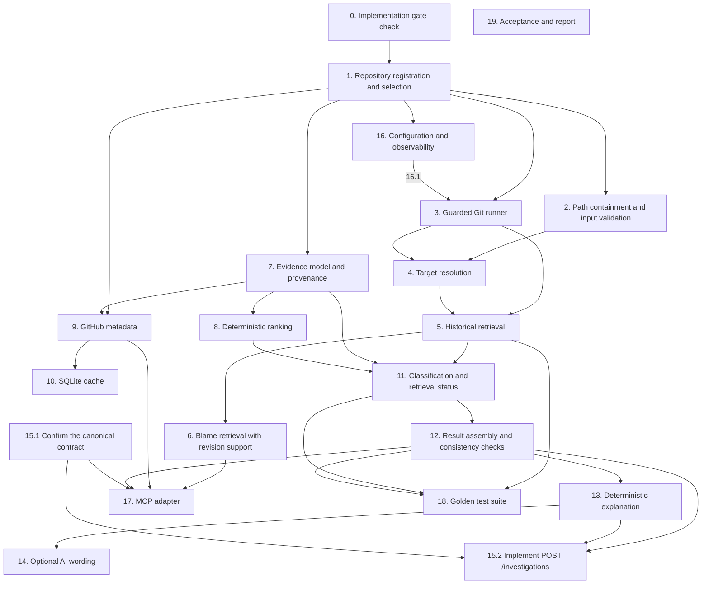

# Implementation Plan: Evidence Retrieval (Native Spec)

## Overview

This plan turns the Evidence Retrieval requirements and design into ordered implementation tasks. It has 20 top-level tasks and 55 subtasks (75 checkboxes). Checkbox state is not a status record. Status is recorded in phase-status. Each task lists the requirements it covers.

**Status (2026-11-12): the amended text below is the Native Spec task baseline. Owner regularization is recorded in phase-status section 42. Provenance of each change is recorded there.** The earlier header, "NOT APPROVED. No task may start.", contradicted the owner's OD-16 approval and the task authorizations recorded in `.kiro/reports/phase-status.md` (sections 7 to 38). Task state is recorded in phase-status and the Phase 3 closure report. The checkboxes in this file are not a status record. The conditions below still apply to any task that has no recorded owner authorization:

1. A human approves `requirements.md` and `design.md`.
2. The implementation gate in Spec 1 §25 and Architecture §25 is closed, or the owner explicitly accepts a narrower scope.
3. The task is approved by the owner, as Operating Guide Phase 3 requires for non-trivial work.

Task 0 is the gate check. It produces a report and changes no code. Tasks that depend on an open decision (see `design.md`, Open decisions) must not start until that decision is recorded.

Tasks are ordered by dependency. Within a numbered group, sub-tasks may run in any order unless a dependency is stated.

## Task Dependency Graph

Execution waves for Kiro's task runner are in the JSON block below. Each entry is a leaf task number: a subtask, or a top-level task that has no subtasks. A wave holds the tasks whose prerequisites are all in earlier waves. Subtasks of one task can fall in different waves when their stated prerequisites differ (for example, 15.1 is in wave 0, 15.2 is in wave 9, and 3.x waits for 16.1). Kiro treats every task in a wave as depending on all tasks in earlier waves, so the waves serialize some tasks more than the explicit dependencies require. The explicit dependencies are in the diagram and table after the JSON block. Task 17 is placed after task 12, its latest prerequisite. Subtask 17.1 also names the approved contract (15.1) as a prerequisite.

```json
{
  "waves": [
    { "id": 0, "tasks": ["0","15.1"] },
    { "id": 1, "tasks": ["1.1","1.2","1.3"] },
    { "id": 2, "tasks": ["2.1","2.2","2.3","2.4","7.1","7.2","7.3","16.1","16.2"] },
    { "id": 3, "tasks": ["3.1","3.2","3.3","3.4","8.1","8.2","8.3","9.1","9.2","9.3"] },
    { "id": 4, "tasks": ["4.1","4.2","10.1","10.2"] },
    { "id": 5, "tasks": ["5.1","5.2","5.3","5.4"] },
    { "id": 6, "tasks": ["6.1","6.2","6.3","11.1","11.2"] },
    { "id": 7, "tasks": ["12.1","12.2","12.3"] },
    { "id": 8, "tasks": ["13.1","13.2","17.1","17.2","17.3","17.4","17.5","18.1","18.2","18.3"] },
    { "id": 9, "tasks": ["14.1","14.2","15.2"] },
    { "id": 10, "tasks": ["19.1","19.2","19.3"] }
  ]
}
```

Each edge points from a prerequisite task to the task that depends on it. Edges come only from the dependency text already written in the task headers and subtasks. No dependency is inferred from task numbering or order.



Not drawn: task 19 depends on every task from 0 to 18. The table lists this dependency. Ouija Experience tasks 1 and 7 depend on subtask 15.1 (see Notes).

| Task | Depends on (as written in the task) | Other prerequisites stated in the task |
|---|---|---|
| 0 | none | Gate documents in Spec 1 §25 and Architecture §25 |
| 1 | 0 | Owner decision E-D1 recorded first |
| 2 | 1 | none stated |
| 3 | 1, 16.1 | none stated |
| 4 | 2, 3 | none stated |
| 5 | 3, 4 | none stated |
| 6 | 5 | none stated |
| 7 | 1 | none stated |
| 8 | 7 | none stated |
| 9 | 1, 7 | none stated |
| 10 | 9 | Cache invalidation defined after D06 is decided (subtask 10.1) |
| 11 | 5, 7, 8 | none stated |
| 12 | 11 | none stated |
| 13 | 12 | none stated |
| 14 | 13 | A provider is selected and approved, E-D13 (header, subtask 14.1) |
| 15 | none at the header. 15.1: design approval only. 15.2: 12, 13.1, 13.2, and 15.1 | Owner decision C-D5 (15.2). 15.1 depends on no Ouija task |
| 16 | 1 | Task 16.1 values must be verified and owner-approved before task 3 starts (O-G1) |
| 17 | 6, 9, 12; and 15.1 (stated in subtask 17.1) | Owner approval of this task (header, subtask 17.1) |
| 18 | 5, 11, 12 | Approved D03 baseline already recorded; D04 is an outcome of this task |
| 19 | 0 to 18 (every task) | none stated |

## Tasks

- [ ] 0. Implementation gate check
  - Confirm each gate in Spec 1 §25 and Architecture §25: approved documents, verified Kiro configuration formats for 1.4.121, Windows dependency compatibility, the Golden repository and baseline (D03), the license holder before any `LICENSE` file, and the cross-document consistency review.
  - Confirm that the owner decisions are recorded in `design.md` (E-D1, E-D2, E-D4, E-D9, C-D1 to C-D4, C-D6 to C-D10, and DEC-13 keep-as-is). C-D5 (`investigation_id` format) is decided: a UUID version 4 string. Task 15.1 records that confirmation. Confirm that no open decision is needed by the task being started.
  - Report each gate as closed or open. Do not infer closure from document approval alone.
  - _Requirements: Spec 1 §25; Architecture §25_

- [ ] 1. Repository registration and selection (depends on 0; owner decision E-D1 must be recorded first)
  - [ ] 1.1 Define the registry JSON file at `%LOCALAPPDATA%\Sean\config\repositories.json` with the schema in `design.md` ("Repository registration and selection"): `schema_version`, and entries with `repository_id`, `root`, and optional `github` (`owner`, `name`). Reject unknown keys (E-D1, DEC-3).
  - [ ] 1.2 Implement read-only loading at startup in `repository`, with validation of each entry. Exclude and report invalid entries, and keep the others working. Provide one resolve function that returns the resolved root and GitHub identity, and returns `REPOSITORY_NOT_FOUND` or `REPOSITORY_UNAVAILABLE`.
  - [ ] 1.3 Read the explicit `github` object from the entry. Return `GITHUB_IDENTITY_UNRESOLVED` when it is absent. Never derive owner or name from a Git remote (E-D2, DEC-4).
  - _Requirements: 1.1 to 1.7_

- [ ] 2. Path containment and input validation (depends on 1)
  - [ ] 2.1 Apply the path rules in canonical C.3a, implemented once in `repository`, to normalize repository-relative paths. Verify junction and reparse-point handling on Windows. Reject traversal, drive letters, UNC paths, alternate data streams, reserved names, and trailing dots or spaces.
  - [ ] 2.2 Check containment on resolved paths, including symbolic links and junctions.
  - [ ] 2.3 Validate symbol and file inputs before any use.
  - [ ] 2.4 Request a security review before this task closes, because it handles paths (Playbook §8).
  - _Requirements: 2.1, 2.4, 14.2 to 14.7_

- [ ] 3. Guarded Git runner (depends on 1 and 16.1)
  - [ ] 3.1 Implement the single subprocess function in `core`: argument array, explicit working directory, controlled environment, timeout, byte limit, no shell.
  - [ ] 3.2 Add the option set that neutralizes repository-controlled programs. Verify it against the installed Git before relying on it (D02 §16.9 item 4).
  - [ ] 3.3 Reject input that starts with `-` before it reaches Git.
  - [ ] 3.4 Test that the runner passes no inherited secrets and reports errors without environment values.
  - _Requirements: 14.1, 15.1 to 15.6_

- [ ] 4. Target resolution (depends on 2, 3)
  - [ ] 4.1 Resolve symbols and code regions in the current state, and return ambiguity with its candidates.
  - [ ] 4.2 Continue historical search when the current location is absent.
  - _Requirements: 2.2, 2.3_

- [ ] 5. Historical retrieval (depends on 3, 4)
  - [ ] 5.1 Retrieve commits for a file or symbol, including renames, moves, and deletions where history permits.
  - [ ] 5.2 Detect shallow clones and missing history. Add the matching limitations and cap the retrieval status at `PARTIAL`.
  - [ ] 5.3 Mark heuristic rename and copy detection as heuristic in the result.
  - [ ] 5.4 Retrieve repository documentation whose history touches the target, return it as `DOCUMENTATION` evidence with its commit and path, and claim no documentation evidence when none is found (E-D16 scope).
  - _Requirements: 3.1 to 3.4, 4.6_

- [ ] 6. Blame retrieval with revision support (depends on 5)
  - [ ] 6.1 Implement blame for a path and line range at a revision that is a full SHA-1 (40 characters) or SHA-256 (64 characters) object name, defaulting to HEAD when omitted (E-D4, DEC-14).
  - [ ] 6.2 Reject every other revision value before any Git call, including branch names, tags, abbreviated SHAs, and expressions (`HEAD~1`, `a..b`, `@{...}`, `:/text`). Report `REVISION_NOT_FOUND` for a SHA that is not in the repository, and `PATH_NOT_FOUND` for a path missing at the resolved commit.
  - [ ] 6.3 Report uncommitted lines as a limitation, without inventing a commit.
  - _Requirements: 3.1, 13.1, 13.8_

- [ ] 7. Evidence model and provenance (depends on 1)
  - [ ] 7.1 Implement the evidence item fields and the source-type enumeration.
  - [ ] 7.2 Derive identifiers from the namespace and source identifiers only.
  - [ ] 7.3 Keep unavailable fields distinct from verified absence.
  - _Requirements: 1.2, 4.1 to 4.5_

- [ ] 8. Deterministic ranking (depends on 7)
  - [ ] 8.1 Implement the Spec 1 §9 criteria with configurable weights (E-D5).
  - [ ] 8.2 Implement the deterministic tie-break and store the per-criterion awards. Order by score descending, then by evidence_id ascending using ordinal UTF-8 byte comparison, with no locale collation and no case folding.
  - [ ] 8.3 Treat missing metadata as no award, not as evidence.
  - _Requirements: 6.1 to 6.5_

- [ ] 9. GitHub metadata (depends on 1, 7)
  - [ ] 9.1 Retrieve public pull request and issue records with timeouts, size bounds, and no redirects to other hosts (E-D8).
  - [ ] 9.2 Validate that each record belongs to the registered repository. Return `GITHUB_IDENTITY_MISMATCH` otherwise.
  - [ ] 9.3 Map rate-limit, network, and not-found outcomes to limitations, never to proof of absence.
  - _Requirements: 5.1 to 5.4, 16.1 to 16.5_

- [ ] 10. SQLite cache (depends on 9)
  - [ ] 10.1 Store cache entries with repository and source identity. Define invalidation after D06 is decided.
  - [ ] 10.2 Flag stale entries served after a failed live request. Keep retrieval working when the cache is absent.
  - _Requirements: 17.1 to 17.4_

- [ ] 11. Classification and retrieval status (depends on 5, 7, 8)
  - [ ] 11.1 Implement the four retrieval statuses and the four classifications, as separate fields.
  - [ ] 11.2 Implement the classification rules from the evidence supporting each claim.
  - _Requirements: 7.1 to 7.4, 8.1 to 8.3_

- [ ] 12. Result assembly and consistency checks (depends on 11)
  - [ ] 12.1 Assemble the investigation result with every field listed in Spec 1 §10.3.
  - [ ] 12.2 Enforce the consistency rules in `design.md`. Return `INTERNAL_ERROR` as `FAILED` on violation. Never edit a value silently.
  - [ ] 12.3 Keep cancellation separate from every status and classification.
  - _Requirements: 9.1 to 9.8, 12.1 to 12.3_

- [ ] 13. Deterministic explanation (depends on 12)
  - [ ] 13.1 Build templates from verified fields that state the fact, the inference, and what is unknown.
  - [ ] 13.2 Abstain when evidence is insufficient. Include source references and limitations.
  - _Requirements: 10.1 to 10.3_

- [ ] 14. Optional AI wording (DEFERRED by owner decision, 2026-11-10; depends on 13 and, before reconsideration, on the E-D13 decisions AI-3 and AI-5 to AI-10)
  - [ ] 14.1 DEFERRED by owner decision, 2026-11-10. Reconsideration requires: the E-D13 privacy gate (AI-3) closed with a demonstrably useful privacy-compliant payload, approved payload and validation rules (AI-9, AI-10), a separate owner authorization, and owner approval of any dependency (Operating Guide §9). The provider and model are already approved (AI-2, AI-4).
  - [ ] 14.2 Accept only the verified fields as input. Reject output that adds facts or removes limitations. Fall back to the deterministic explanation on any failure.
  - _Requirements: 11.1 to 11.4_

- [ ] 15. HTTP investigation endpoint
  - [ ] 15.1 (depends on: design approval; owner decision C-D5, recorded as UUID v4) Confirm the canonical contract in `design.md` (section "Shared integration contract (canonical)"). The owner decisions recorded in its C.13 table are closed. This task records the confirmation only. It is a documentation step with no code, and it depends on no other task and on no Ouija task.
  - [ ] 15.2 (depends on: tasks 12, 13.1, and 13.2; task 15.1; owner decision C-D5) Implement `POST /investigations` in `api` with the status mapping in design C.11 (200 for any category A result, 400, 404, 409 for `TARGET_AMBIGUOUS`, 503, and 500). It calls the investigation and explanation functions and nothing else. Map each error to category A, B, or C (design C.5). Never return a category B error as an investigation result.
  - _Requirements: 9.1, 9.8, 13.2_

- [ ] 16. Configuration and observability (depends on 1)
  - [ ] 16.1 Implement the configuration areas in Requirement 18.1, with secrets read only from local mechanisms. Include numeric request and output limits and timeouts (DEC-10, E-D14). Do not add an overall investigation deadline (design C.8, C-D3). Owner gate: the numeric values must be approved by the owner before this task is verified. Task 3 cannot start until this task is verified.
  - [ ] 16.2 Record the diagnostic fields in Requirement 19.1 and exclude secrets and tokens from logs.
  - _Requirements: 18.1 to 18.4, 19.1, 19.2, 20.1 to 20.4_

- [ ] 17. MCP adapter (depends on 6, 9, 12, and owner approval of this task)
  - [ ] 17.1 Implementation prerequisites: the approved contract (15.1) and owner approval of this task. D02 closure is not needed to implement the module. Runtime enablement in Kiro is governed by 17.5 and owner decision C-D7.
  - [ ] 17.2 Implement the four tools as thin adapters over the same functions as `api`. Validate inputs and return structured errors.
  - [ ] 17.3 Implement STDIO entry point at `app.modules.mcp` with stdout reserved for protocol messages and logs on stderr.
  - [ ] 17.4 Run the tool-level tests MCP-01 to MCP-18 (D02 §16.11).
  - [ ] 17.5 Validate or correct `.kiro/settings/mcp.json` against the implemented module. The owner decided to keep the file unchanged until this task (DEC-13). Change only what the implemented module requires. Do not start the module or enable the server in Kiro here. Enabling it for runtime use waits for D02 closure and Architecture §12.2 (C-D7).
  - _Requirements: 13.1 to 13.7_

- [ ] 18. Golden test suite (depends on 5, 11, 12; the approved D03 baseline is already recorded; D04 is an outcome of this task, not a blocker)
  - [ ] 18.1 Use the baseline commit approved in D03: `9e7cc2b628fe8fd3895986af9b7fc9525034c1b0`. Verify it with the procedure in D03 section 7 before any Golden test is written. Tests reference the SHA, never a branch or tag name.
  - [ ] 18.2 Implement G01 to G10 with the required fields in Requirement 22.3.
  - [ ] 18.3 Execute the suite. Report results as validated only after execution against the pinned baseline.
  - _Requirements: 22.1 to 22.3_

- [ ] 19. Acceptance and report (depends on 0 to 18)
  - [ ] 19.1 Map each Spec 1 §23 criterion to executed evidence. Mark any criterion without evidence as not verified.
  - [ ] 19.2 Produce the Playbook §15 task report for each completed task, with changed files, commands run, observed results, and unresolved issues.
  - [ ] 19.3 Do not mark any task ACCEPTED. Only the owner does that.
  - _Requirements: 21.1 to 21.2, 23.1 to 23.3_

## Notes

Format note: Kiro's documentation describes checkbox tasks in `tasks.md` and a dependency graph that Kiro builds from that file. The exact syntax and how dependency text is recognized are not verified for IDE 1.4.121. The "depends on" text is written for human readers. Do not use "Run all Tasks" before the owner approves this plan.

Status mapping: a `[ ]` checkbox means `NOT_STARTED`. No checkbox is marked complete for `VERIFIED` or `ACCEPTED`. Task status uses the Engineering Playbook §15 vocabulary (`NOT_STARTED`, `IN_PROGRESS`, `BLOCKED`, `IMPLEMENTED`, `VERIFIED`, `ACCEPTED`). Only the owner marks `ACCEPTED`.

### Dependencies on the Ouija Experience spec

- Task 15.1 approves the canonical contract. Ouija tasks 1 and 7 depend on it.
- Acyclic order: 15.1, then Ouija tasks 1 and 7, then 15.2 and the Ouija integration checks. No task in this plan depends on any Ouija task.
- The Ouija spec does not change any backend requirement in this spec.
