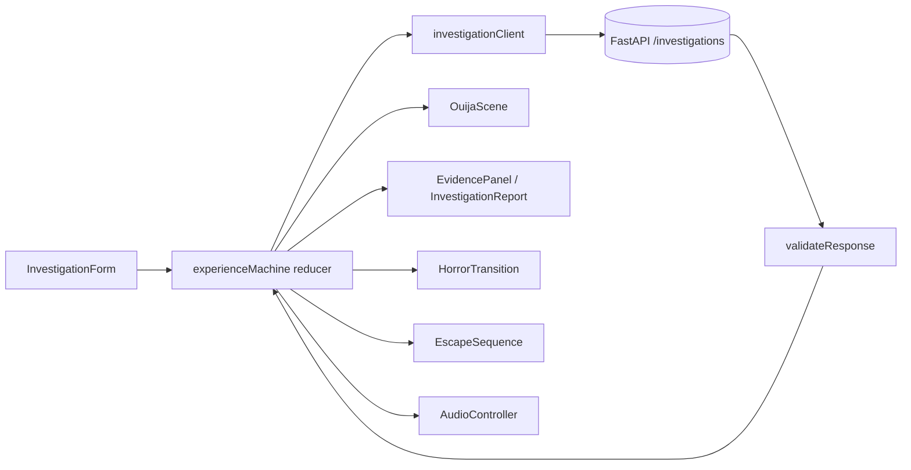

# Design Document: Immersive Experience (Native Spec)

## Overview

This design realizes the immersive-experience requirements as a React and TypeScript frontend with two primary zones and one experience reducer. It uses `useReducer`, CSS, and browser APIs only. It consumes the backend contract defined in the Evidence Retrieval design and the real `POST /investigations` implementation, and it defines no contract fields of its own.

### Sources and authority

- Requirements: `requirements.md` in this folder.
- Experience specification: #[[file:docs/specs/spec-3-immersive-experience.md]].
- Approved product sources: Spec 1 v2.4 and Spec 2 v1.6. Conflicts and resolutions are in Spec 3 §2.
- Contract: #[[file:.kiro/specs/evidence-retrieval/design.md]], "Shared integration contract (canonical)", checked against `backend/app/api/app.py`.

### Design principles

1. **Backend values are authoritative.** Stored as received, never edited.
2. **Derive, do not decide.** One pure function maps backend values to the presentation state.
3. **Motion and sound follow state.** The planchette stage, the cinematic and the audio mood are functions of the phase.
4. **Fiction is a layer.** The narrative layer reads the result and never writes to it.
5. **Pure cores, thin components.** The reducer, the validator, the clue builder, and the game engine are pure and tested without a DOM.
6. **Native tools only.** No animation library, no state library, no game engine.

## Architecture

The experience reducer owns the phase, the request token, the validated result, the question, the settled flag, the collected clue ids, and the error. Settings (motion, horror switch, volume) are held in a separate settings store. Audio is held in a controller object and is driven by effects keyed on the phase.

### Experience phases

`IDLE`, `INVESTIGATING (INVOKING, RETRIEVING)`, `REVEALING (settled)`, `NARRATIVE_INTERRUPTION`, `ESCAPE_SEQUENCE`, `FINAL_REPORT`, `ERROR`, `CANCELLED`. The full transition table is in Spec 3 §4.

### Presentation derivation

`deriveUiState` implements Spec 2 §8.5 in priority order. `validateResponse` runs first and rejects a body with a missing field, an unrecognized value, or a combination that no row of the table allows. An invalid body never reaches the reducer as a result.

### Planchette stages

`REST` (idle and every non-success end state), `WAKE` (invoking), `SEARCH` (retrieving, a fixed path), `REVEAL_PREP` (revealing, not settled), `SETTLED` (revealing, settled, and later phases). The stage is a pure function of the phase and the settled flag. Reduced motion replaces movement with a position change and a text status.

### Narrative timing

The settle event is raised by the planchette's transition end, with a timer fallback so reduced motion and a missing event do not stall the flow. The interruption timer is scheduled 2000 ms after the settled flag becomes true, and only for an eligible result. Fake timers make the timing testable at 1999 ms and 2000 ms. Skipping clears the timer.

### Escape engine

A pure module. The map is 11 by 9 tiles from a seeded generator (a hash of the investigation ID into a 32-bit generator). It carves a maze with a depth-first walk, which guarantees connectivity. Fragments, hiding alcoves, the exit, and the presence's patrol are placed on distinct reachable floor tiles. The engine exposes `createGame`, `step`, and `canComplete` (a breadth-first search over the grid). One `step` is one player action followed by one presence move. The catch rules (slow after two catches and dormant after four) are part of `step`. A solver test runs `canComplete` over many seeds and fragment counts.

### Clues

`buildClues(result)` maps the first four evidence items, in returned order, to fragments. A fragment holds only a subset of that item's fields. It has no author field. A fragment label is built from the item's title, or its file path, or its source type and identifier, and is never invented.

### Audio

`AudioController` wraps a `Web Audio` context created lazily on `enable()`. It exposes `enable`, `setMuted`, `setVolume`, `setMood`, `cue`, and `dispose`. A master gain feeds a dynamics compressor. The ambient bed is two detuned low oscillators with a slowly modulated filter, plus a quiet noise layer. Mood changes cross-fade the bed. One-shot cues are short envelopes with a cap on concurrency. A fake context drives the unit tests. Success cues are guarded by the same eligibility function as the interruption.

### Layout and styling

A CSS grid places the left zone first in the DOM. Tailwind provides the theme tokens and layout utilities, and the component CSS in `styles/index.css` provides the board, planchette, glitch, vignette, and game tiles. Nothing is loaded from the network.

## Components and Interfaces

| Location | Module | Responsibility | Requirements |
|---|---|---|---|
| `types/` | `contract.ts` | Types from the real response | 3 |
| `services/` | `investigationClient` | fetch, abort, map result or `BackendError` | 3, 4 |
| `features/investigation/` | `validateResponse`, `deriveUiState` | Contract checks and the §8.5 mapping | 3, 5 |
| `features/experience/` | `experienceMachine`, `useExperience`, `sessionStore`, `settingsStore`, `clues` | Phase reducer, orchestration, persistence, fragments | 4, 8, 12, 13 |
| `features/audio/` | `AudioController`, `AudioProvider` | Synthesis and lifecycle | 11 |
| `features/escape/` | `escapeEngine` | Seeded maze and rules | 9 |
| `components/layout/` | `TwoZoneLayout` | Grid and stacking | 1 |
| `components/ouija/` | `InvestigationForm`, `InvestigationProgress`, `OuijaScene`, `Planchette`, `StatusStrip`, `HorrorTransition` | Setup, board, status, interruption | 2, 5, 6, 8 |
| `features/escape/` | `EscapeSequence`, `EscapeEnvironment`, `EvidenceClue` | Game UI | 9 |
| `components/evidence/` | `EvidencePanel`, `EvidenceCard`, `InvestigationReport` | Evidence and report | 7, 10 |
| `components/settings/` | `ExperienceSettings` | Sound, motion, horror, skip | 11, 12 |
| `app/` | `InvestigationView` | Composition root | all |

## Correctness properties

1. **Backend values are never overwritten.** For any event sequence, the stored result equals the validated response.
2. **No success from non-success.** For any outcome that is `FAILED`, invalid, rejected, network, or cancelled, no reveal, interruption, or success cue occurs.
3. **Eligibility is one function.** The interruption, the success cue, and the game share it.
4. **One call per submission.** The number of API calls equals the number of accepted submissions.
5. **The game is completable.** For every seed and fragment count in range, `canComplete` is true, and a bounded sequence of steps reaches the exit.
6. **Fragments are real.** Every fragment's evidence id is the id of an item in the result.
7. **Idempotent resources.** `dispose` can be called repeatedly and leaves no live node.

## Error handling

See Spec 3 §13. Errors are typed in the reducer and rendered by one component with a distinct heading per kind. The network kind offers a retry. The rejected kind keeps the form editable and shows candidates.

## Testing strategy

Vitest for pure modules and components (jsdom), with fixtures generated by running the real backend and capturing its JSON. Playwright against a real Vite server and a real backend process, using the installed Microsoft Edge, for the complete journey, the responsive layout, and keyboard-only operation. Executed results only.

## Open decisions

None blocks implementation. The following are recorded choices: the question is held client-side (the backend does not echo it); the repository ID is typed (no listing endpoint); the dev server proxies `/api` (no CORS in the backend).
