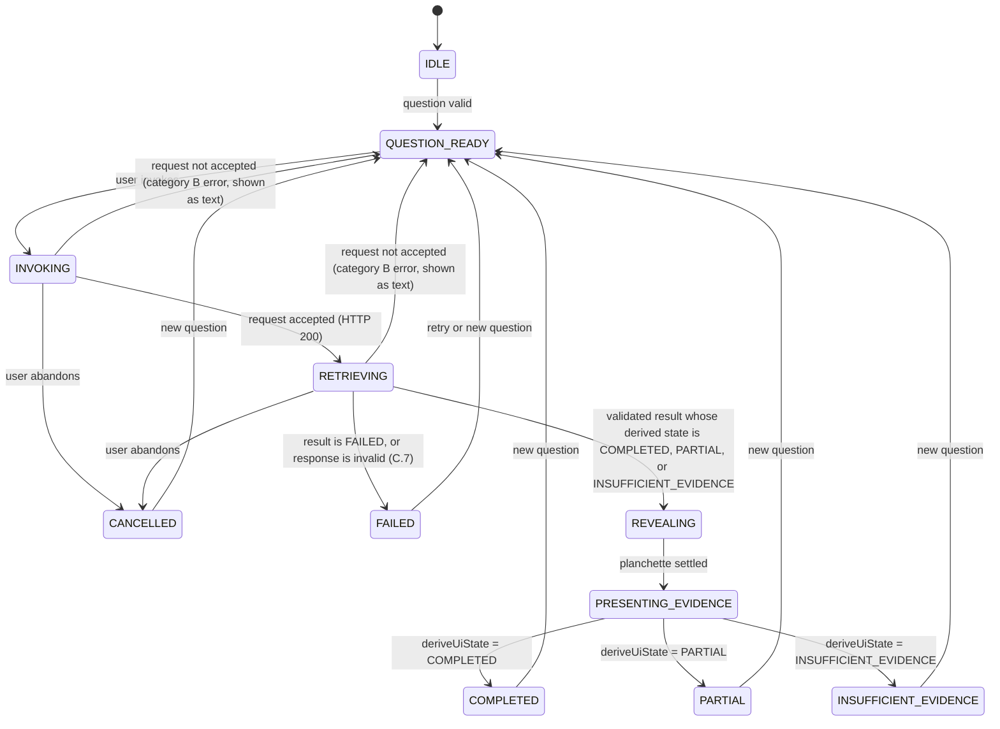

# Design Document: Ouija Experience (Native Spec)

## Overview

This design realizes the Ouija Experience requirements as a React and TypeScript frontend with two primary zones and one state owner. It uses React state with `useReducer`, CSS, and browser APIs only, and it adds no animation or state library. It consumes the backend contract defined once in the Evidence Retrieval design and defines no contract fields.

The sections below follow the Kiro design layout. The original section titles are kept as sub-headings, so existing references to them remain valid.

### Sources and authority

- Requirements: `requirements.md` in this folder, derived from #[[file:docs/specs/spec-2-ouija-experience.md]].
- Frontend architecture: #[[file:docs/architecture/architecture-and-project-setup.md]] §5, §6, §22 (frontend organization, state, animation, audio).
- Backend contract: defined once, in `.kiro/specs/evidence-retrieval/design.md`, section "Shared integration contract (canonical)". This design defines no contract fields.
- Where a choice is not settled by an approved document, it is listed under Open decisions with a stated fallback. It is not presented as settled.

### Design principles

1. **Backend values are authoritative.** The frontend stores them as received and derives presentation from them. It never edits them (Spec 2 §17.4).
2. **Derive, do not decide.** Presentation comes from one pure function over backend values and lifecycle state (Spec 2 §8.5).
3. **Motion follows state.** The planchette position is a function of the lifecycle state, not of time alone or randomness (Spec 2 §6.4, Architecture §6.6).
4. **Native tools only.** React state with `useReducer`, CSS, and browser APIs. No animation or state library (Architecture §6.4, §6.6; Spec 2 §22.3).
5. **Two zones, one reducer.** One state owner drives both zones (Architecture §6.4).

## Architecture

One reducer owns the investigation state and drives both zones (Architecture §6.4). The sections below describe the lifecycle, the presentation derivation, the planchette stages, the layout, and the styling approach.

### Lifecycle transitions



Rules:
- `CANCELLED` is reachable only from `INVOKING` and `RETRIEVING`. Cancellation never routes through `REVEALING`.
- `REVEALING` may be entered only with a validated result whose derived state is `COMPLETED`, `PARTIAL`, or `INSUFFICIENT_EVIDENCE`. A `FAILED` result never reveals. It goes directly to `FAILED` (Spec 2 §8.6, §12.3).
- A category B request error (C.5: `INVALID_INPUT`, `PATH_OUTSIDE_REPOSITORY`, `REPOSITORY_NOT_FOUND`, `TARGET_AMBIGUOUS`, `REPOSITORY_UNAVAILABLE`, or an HTTP error) returns to `QUESTION_READY`, with the text "request not accepted" and the backend message. It is never shown as a retrieval failure, and the question stays editable (Requirement 24.5, 4.3). `TARGET_AMBIGUOUS` also shows the candidates.
- `FAILED` covers only category A `FAILED` results and invalid responses (C.7).
- A request while `INVOKING`, `RETRIEVING`, or `REVEALING` is ignored, with a text message (Requirement 5.2).
- `CANCELLED` is entered by the user (client abandonment, canonical contract C.8). The client stops waiting, aborts the request where the transport allows, and discards any later response. A new investigation supersedes an older one: a response is applied only when its client-side request token is current. No cancel endpoint exists in the MVP (C-D9), so the backend keeps no completed record for a cancelled investigation.

### Presentation derivation

`deriveUiState(result)` is a pure function that implements Spec 2 §8.5 in the same priority order:

| Priority | Backend condition | Presentation state |
|---|---|---|
| 1 | `retrievalStatus = FAILED` | `FAILED` |
| 2 | `classification = INSUFFICIENT_EVIDENCE` | `INSUFFICIENT_EVIDENCE` |
| 3 | `classification = PARTIAL_EVIDENCE` | `PARTIAL` |
| 4 | `retrievalStatus` is `PARTIAL` or `INSUFFICIENT`, and `classification` is `DOCUMENTED` or `INFERRED` | `PARTIAL` |
| 5 | `retrievalStatus = COMPLETE`, and `classification` is `DOCUMENTED` or `INFERRED` | `COMPLETED` |
| - | Any other combination | Invalid (see Open decisions, O-D1) |

`validateResponse` runs before `deriveUiState`. It checks required fields, recognized values, and that the status and classification combination matches a row of the table above (Spec 2 §8.5, §18.5, canonical C.7). It does not re-check the backend invariants of Spec 1 §10.4, which the backend enforces. If the frontend finds a contradiction, it treats the response as invalid and never reveals a conclusion. The invalid-response presentation is defined in the canonical contract (C.7, owner decision C-D8). It is a presentation state, not a backend status.

### Planchette stages and reveal

| Stage | Entered when | Motion | Reduced-motion behavior |
|---|---|---|---|
| `REST` | Idle, after completion, and after `FAILED`, `CANCELLED`, or a request not accepted | Planchette at its rest position. No reveal runs on these paths. | Same. |
| `WAKE` | `INVOKING` begins | Short movement from rest. | Static highlight only. |
| `SEARCH` | `RETRIEVING` | Deliberate slow movement along the board. Pattern is fixed, not random. | Static position with a text status line. |
| `REVEAL_PREP` | `REVEALING` begins | Movement toward the final position. | Immediate move to the final position. |
| `SETTLED` | Movement ends | Planchette holds at its final position. | Same. |

- Movement is driven by stage changes only. The fixed path and easing are configuration values that do not depend on the result content.
- The complete phrase is inserted into `ResultReveal` when `SETTLED` is reached. It is one text node. No per-letter elements are created (Requirement 9.2).
- Skip sets `motion.skipped`. The stage jumps to `SETTLED`, the same phrase appears, and retrieval and validation are not changed (Requirement 19.3).
- Stage timing values are not specified by Spec 2. They are open decision O-D5.

### Responsive layout

- The two zones use a CSS grid. The left zone is listed first in the DOM, so narrow screens stack it in reading order (Architecture §6.3).
- The breakpoint values are not specified by Spec 2. They are open decision O-D6.
- Selected evidence is kept when the layout changes, because it is held in state, not in the component tree (Architecture §6.3).

### Investigation concurrency

Spec 2 §6.3 allows either a single running investigation or concurrent ones. This design chooses one at a time. The reducer ignores invocation while a request is in flight. This choice reduces the state surface and matches the single-owner state design. It is a design choice, and the owner may change it.

### Styling

- Tailwind CSS is the primary styling approach. Native CSS is used only where Tailwind cannot express the board and planchette motion (Spec 2 §22.2).

## Components and Interfaces

The component split follows the folder layout in Architecture §5. The sections below cover the components, evidence presentation, accessibility, sound, and the backend contract that the frontend consumes.

### Frontend component structure

The component names below are the proposed split. They follow the folder layout in Architecture §5 (`app/`, `components/ouija/`, `components/evidence/`, `components/layout/`, `features/`, `hooks/`, `services/`, `types/`, `styles/`).

| Location | Component or module | Responsibility | Requirements |
|---|---|---|---|
| `components/layout/` | `TwoZoneLayout` | Desktop grid with left and right zones, and vertical stacking on narrow screens. Reserves zone dimensions. | 1, 2 |
| `components/evidence/` | `EvidenceHistoryPanel` | Left zone: empty and concealed states, evidence cards, selected detail, explanation, timeline. | 2, 14, 15, 16, 17, 18 |
| `components/ouija/` | `OuijaBoardPanel` | Right zone container: question, invocation, board, status strip, controls. | 3, 4, 5 |
| `components/ouija/` | `OuijaBoard` | Board artwork and planchette layer. Receives a stage value and renders it. | 3, 8, 9 |
| `components/ouija/` | `Planchette` | Positioned element driven by planchette stage and reduced-motion setting. | 8, 19, 22 |
| `components/ouija/` | `ResultReveal` | Shows the complete phrase or the neutral status after the stage is `SETTLED`. | 9, 10, 11, 12 |
| `components/ouija/` | `StatusStrip` | Shows original retrieval status and classification as separate labeled values. | 7, 12 |
| `components/ouija/` | `SoundControls`, `MotionControls` | Enable, mute, volume, skip, and reduced-motion control. | 19, 20 |
| `features/investigation/` | `investigationReducer`, `deriveUiState`, `validateResponse` | Lifecycle state, presentation derivation, and contract validation. | 6, 7, 24 |
| `services/` | `investigationClient` | Calls the backend endpoint and maps its result or error into the contract type. | 24 |
| `types/` | `InvestigationResult`, `EvidenceRecord`, `BackendError` | TypeScript shapes derived from the backend contract. | 24 |

Shared visual parts go in `components/`, and feature logic goes in `features/` (Architecture §5).

### Evidence presentation

- `EvidenceHistoryPanel` renders the evidence records returned by the backend in their received order, or in the order the backend specifies when it provides one (Requirement 14.1).
- Selecting a card sets `selectedEvidenceId`. The detail view uses only fields from that record. Missing fields are shown as unavailable, not filled in (Requirement 17.3).
- Each record's `source_url` is rendered as a link only when its scheme is `https`. Any other value is shown as plain text, so no link can run a script or open an unexpected scheme (Spec 2 §2.3, Architecture §18).
- The explanation and timeline come from the backend. The timeline shows verified dates in one style and inferred links in another, with a text label for each (Requirement 15.2).
- The panel's dimensions are reserved from the first render. The concealed state is an empty, fixed-height container (Requirement 2.2).

### Accessibility

- All controls are native buttons, inputs, or labeled checkboxes, so keyboard use works without custom handlers (Requirement 21.1).
- A polite live region announces each lifecycle change in text, for example "Investigation complete. Evidence available." (Requirement 21.2).
- Focus moves only on user actions: to the question field on `QUESTION_READY` (including after a request not accepted, where focus goes to the inline message), and to the status heading when a result or a `FAILED` or `CANCELLED` state is presented. It never moves during an animation (Requirement 21.3).
- Contrast and type sizes are checked during review. Decorative board art has `aria-hidden`.

### Sound

- Sound is off by default. Enabling it is an explicit user action (Requirement 20.1).
- Playback uses the browser's native audio API with local asset files that carry their licenses. No remote audio source is used (Requirement 20.4).
- Sound cues attach to lifecycle entries only. The `INVOKING` cue is neutral. The reveal cue fires only when the derived presentation is `COMPLETED` or `PARTIAL`. `REVEALING` is also entered for `INSUFFICIENT_EVIDENCE`, so that path has no cue at all. No cue is attached to `FAILED`, `CANCELLED`, request-not-accepted, or `INSUFFICIENT_EVIDENCE` (Requirement 20.3).

### Backend contract

The frontend consumes the investigation result defined in the canonical contract. The canonical contract covers the fields that Spec 2 §18.2 requires and states their presence rules. This design does not repeat them, so no field can be defined in two places.

- Route, status codes, request fields, and cancellation are closed owner decisions in the canonical contract (C-D1, C-D3, C-D4). The `investigation_id` format (C-D5) is a UUID version 4 string, decided in the canonical contract and recorded at Evidence Retrieval task 15.1. The frontend types are defined after that task.

## Data Models

The reducer owns one state object, defined below. The backend result type is defined by the canonical contract, not here.

### State model

The reducer owns one state object. Three values are kept apart:

```text
InvestigationState
  lifecycle: IDLE | QUESTION_READY | INVOKING | RETRIEVING | REVEALING
           | PRESENTING_EVIDENCE | COMPLETED | PARTIAL | INSUFFICIENT_EVIDENCE
           | FAILED | CANCELLED                       (frontend, Spec 2 §8.2)
  question: string
  result: InvestigationResult | null                   (backend, unmodified)
    retrievalStatus: COMPLETE | PARTIAL | INSUFFICIENT | FAILED
    classification: DOCUMENTED | INFERRED | PARTIAL_EVIDENCE | INSUFFICIENT_EVIDENCE | absent
    conclusion: string | absent
    evidence: EvidenceRecord[]
    limitations: Limitation[]
  selectedEvidenceId: string | null
  planchetteStage: WAKE | SEARCH | REVEAL_PREP | SETTLED | REST
  motion: { reduced: boolean, skipped: boolean }
  sound: { enabled: boolean (default false), volume: number }
  error: BackendError | null
```

`lifecycle` and `planchetteStage` are related but separate. `lifecycle` follows the Spec 2 §8.2 list. `planchetteStage` is a view of lifecycle plus the reveal timing.

## Correctness Properties

These properties restate rules from the approved requirements so that tests can check them. They add no new rule. None of the verification tests described below has been written or run.

### Property 1: Presentation state follows the deterministic mapping

For any valid pair of retrieval status and classification, `deriveUiState` returns the presentation state of the first matching row in the Presentation derivation table. Any missing, unrecognized, or contradictory combination yields the invalid-response presentation and never a successful conclusion.

Applies to: `deriveUiState` and `validateResponse`.

**Validates: Requirements 7.2, 7.5**

Verification: a Vitest test enumerates every combination of the four statuses and the four classifications, plus an absent classification, and asserts the matching row or the invalid result.

### Property 2: Backend values are never overwritten

For any sequence of reducer actions, the stored retrieval status, classification, conclusion, evidence, and limitations equal the values received. The derived presentation state is stored and shown separately.

Applies to: the investigation state object.

**Validates: Requirements 7.1, 7.3, 7.4**

Verification: a Vitest test applies generated action sequences and deep-compares the stored backend values with the input. Component tests render both the original values and the derived state.

### Property 3: A successful reveal requires a validated successful result

For any lifecycle path, `REVEALING` is entered only with a validated result whose derived state is `COMPLETED`, `PARTIAL`, or `INSUFFICIENT_EVIDENCE`. A `FAILED` result, an invalid response, and a cancellation never pass through `REVEALING`.

Applies to: the lifecycle transitions.

**Validates: Requirements 6.3, 13.1, 13.3**

Verification: a model-based Vitest test explores the reducer transitions and asserts reachability. A Playwright test asserts that no reveal element appears for a failed or cancelled investigation.

### Property 4: The revealed phrase is the backend text

For any presented result, the revealed phrase equals the backend conclusion. A `COMPLETED` or `PARTIAL` presentation is not broadened or reworded, and a `PARTIAL` presentation reveals only the narrow conclusion the backend supplied.

Applies to: `ResultReveal`.

**Validates: Requirements 9.3, 10.1, 10.3, 11.1**

Verification: component tests with generated conclusion strings assert exact text equality for each state.

### Property 5: Classification and limitations stay visible

For any `COMPLETED` or `PARTIAL` presentation, the classification is displayed next to the conclusion. For a `PARTIAL` presentation, the coverage limitations are visible, and the result is not presented as a complete historical explanation.

Applies to: `ResultReveal` and `StatusStrip`.

**Validates: Requirements 10.2, 11.2, 11.3**

Verification: component tests assert the classification label in both states and the limitation text in the partial state.

### Property 6: Insufficient evidence reveals no conclusion

For any `INSUFFICIENT_EVIDENCE` presentation, no historical conclusion is revealed. At most the neutral phrase `INSUFFICIENT EVIDENCE` appears, and it is not presented as a historical answer.

Applies to: `ResultReveal`.

**Validates: Requirements 12.1, 12.2, 12.4**

Verification: component tests with a backend result that carries a conclusion string assert that the string never appears. A text assertion checks that the neutral phrase is the only reveal text.

### Property 7: A request not accepted is not a retrieval failure

For any request-level error, the lifecycle returns to `QUESTION_READY`, shows the text "request not accepted" with the backend message, and never enters `FAILED`.

Applies to: the handling of category B errors in the reducer.

**Validates: Requirements 24.5**

Verification: reducer tests for each request-level error code, and a Playwright test with mocked 400, 404, 409, and 503 responses.

### Property 8: The planchette stage is a function of the lifecycle state

For any lifecycle state, the planchette stage and position are the same on every occurrence. No movement is random, and no letters are spelled.

Applies to: `Planchette` and the stage derivation.

**Validates: Requirements 8.2, 8.3, 8.5**

Verification: a pure-function test of the state-to-stage mapping, and a repeated-render test that compares positions for the same state sequence.

### Property 9: The phrase appears whole after the planchette settles

For any result, the complete phrase is inserted as one text node, only after the stage is `SETTLED`, and never letter by letter.

Applies to: `ResultReveal`.

**Validates: Requirements 9.1, 9.2**

Verification: a Playwright test with a mutation observer asserts one insertion of the complete text after `SETTLED` and no insertion before it.

### Property 10: Skip and reduced motion change only the animation

For any result, enabling skip or reduced motion gives the same final lifecycle state, result, and displayed content as full animation. It does not skip retrieval or bypass validation.

Applies to: `MotionControls` and the reveal sequence.

**Validates: Requirements 19.1, 19.2, 19.3**

Verification: each outcome is run with and without skip and reduced motion, and the final state and visible text are compared.

### Property 11: Only the current request's response is applied

For any pair of overlapping requests, a response is applied only when its client-side request token is current. Responses for superseded or abandoned requests are discarded. A cancelled investigation ends in `CANCELLED` and is not converted into a retrieval status or classification.

Applies to: the request token and the `CANCELLED` transition.

**Validates: Requirements 6.4, 6.5**

Verification: a reducer test delivers responses out of order and after cancellation and asserts the resulting state.

### Property 12: One investigation runs at a time

For any invocation while the lifecycle is `INVOKING`, `RETRIEVING`, or `REVEALING`, no second request is sent and a text message is shown. One activation of the invocation control starts one investigation.

Applies to: the invocation control and the reducer.

**Validates: Requirements 5.1, 5.2**

Verification: a test simulates rapid repeated activation and asserts exactly one backend call.

### Property 13: No success sound for failure, cancellation, or insufficient evidence

For any session, sound is disabled until the user enables it. No success-oriented sound plays for `FAILED`, `CANCELLED`, or `INSUFFICIENT_EVIDENCE`.

Applies to: `SoundControls` and the cue mapping.

**Validates: Requirements 20.1, 20.3**

Verification: a unit test of the state-to-cue mapping for every state, and a fresh-session test of the default.

### Property 14: Optional presentation failures never block the investigation

For any audio or animation failure, retrieval, state transitions, and source inspection continue to work. The experience is fully usable with sound disabled.

Applies to: audio playback and animation code.

**Validates: Requirements 20.5, 26.1, 26.2**

Verification: tests inject an audio error and an animation error, then assert that the lifecycle completes and evidence can still be selected.

### Property 15: The frontend displays only what the backend returned

For any evidence record, every displayed field comes from that record. Missing fields are shown as unavailable and are never filled in. Absent optional fields are treated as absent.

Applies to: `EvidenceHistoryPanel` and the evidence detail view.

**Validates: Requirements 17.3, 23.2, 24.6**

Verification: component tests render records with fields removed and assert the unavailable marker and the absence of invented values.

### Property 16: Malformed responses are rejected

For any response with a missing required field, an unrecognized status value, or a violation of the contract's presence rules, `validateResponse` rejects it and no conclusion is shown.

Applies to: `validateResponse` and `investigationClient`.

**Validates: Requirements 24.2, 7.5**

Verification: generated malformed fixtures assert the invalid result and the `FAILED` presentation with the validation message.

### Property 17: Two zones and a stable layout

For any viewport, exactly two primary zones exist. On desktop, Evidence & History is on the left and the Ouija Board is on the right. On a narrow viewport the zones stack vertically. Revealing evidence causes no layout shift.

Applies to: `TwoZoneLayout`.

**Validates: Requirements 1.1, 1.2, 1.3, 2.2**

Verification: Playwright tests at desktop and narrow widths count the primary zones, check their order, and measure layout shift across the reveal.

### Property 18: State changes are available as text and by keyboard

For any lifecycle change, the new state is announced as text. Every essential control is reachable by keyboard. Focus does not move during an animation.

Applies to: the live region, the controls, and focus handling.

**Validates: Requirements 21.1, 21.2, 21.3**

Verification: a Playwright keyboard-only run, live-region assertions for each lifecycle state, and a focus-tracking assertion during the reveal animation.

## Error Handling

The frontend never displays internal exception details and never presents a failure as a conclusion. The failure categories are defined in the canonical contract (C.5). This design handles them as follows.

- Request-level errors (category B) return to `QUESTION_READY` with the text "request not accepted" and the backend message. They are never shown as a retrieval failure (see Lifecycle transitions, Requirement 24.5).
- A retrieval `FAILED` result and an invalid response both present as `FAILED` and never reveal (see Lifecycle transitions, Presentation derivation, and canonical contract C.7).

- Audio failure is caught and logged as a status message. It never blocks state transitions (Requirement 26.1).
- Errors arrive as `BackendError` with a code, a safe message, and a retryable flag. Internal details are never displayed (Requirement 24.4).

Not yet designed: the lifecycle transition taken when the animation itself fails during `REVEALING` (Requirements 13.4 and 26.1). The requirements state the outcome, and this design does not yet define the transition.

## Testing strategy

Tests follow Spec 2 §21.7 and Architecture §18. Each test records its requirement.

- **Vitest:** `deriveUiState` over every valid combination of retrieval status and classification, plus the invalid cases. Reducer transitions, including invalid ones. `validateResponse` on malformed input. Component tests for empty, failed, cancelled, and insufficient states. Reduced-motion and sound-default behavior.
- **Playwright:** the two-zone layout at desktop and narrow widths, keyboard-only use, the reveal sequence, skip behavior, evidence selection, and the absence of layout shift.
- **Review:** visual identity (Requirement 27.4), by comparison with Spec 2 §5.
- No test is reported as passing until it is executed and its result observed (Requirement 28.3).

## Open decisions

| ID | Decision | Fallback until decided | Source |
|---|---|---|---|
| O-D1 | Which presentation state an invalid or contradictory backend response shows. Spec 2 forbids a conclusion but names no state. **Closed by owner decision C-D8.** Spec 2 names no state for this case, so this mapping is a recorded owner decision and a deviation from Spec 2 wording. | Show `FAILED` presentation with the message "The result could not be validated. No conclusion is shown." It must not say the retrieval failed or that evidence is absent. Recommended, because Spec 2 §8.3 defines `FAILED` as the case where no valid investigation result exists. | Spec 2 §8.3, §8.5, §18.5; canonical contract C.7 |
| O-D2 | Resolved by reference. The response shape, request, and cancellation are defined once in the canonical contract (Evidence Retrieval design, C.1 to C.14). Remaining owner decisions are listed in C.13. | Frontend types wait for Evidence Retrieval task 15.1. | Canonical contract; Spec 1 §10.3; Spec 2 §18.2, §8.7 |
| O-D11 | **Closed (owner decision C-D1).** Target input in the interface. The question is natural language, and the backend needs an explicit target (canonical C.10). | An explicit repository-relative `target.path` input in the Ouija zone. The question is shown as text only and is never used as the target. | Spec 1 §5; Spec 2 §6.2 |
| O-D3 | **Closed (E-D1, DEC-3).** How the user selects the repository context in the interface. | A list of the repositories registered in the local JSON configuration file. Selection sends `repository_id` only. No path input. Registration itself is not done in the interface (Evidence Retrieval design, Repository registration and selection). | Spec 2 §6.2, §12.2; Spec 1 §22; E-D1 |
| O-D4 | Font families for decorative and technical text, and their licenses. | System fonts only until a licensed font is chosen. | Spec 2 §5.4, §14.5 |
| O-D5 | Planchette stage timing, path, and easing values. | Tuned in review against Requirement 8. No values are assumed as approved. | Spec 2 §6.4 |
| O-D6 | Responsive breakpoints. | Two breakpoints chosen at implementation and recorded. | Spec 2 §4.4; Architecture §6.3 |
| O-D7 | **Closed (owner).** Sound assets are original or permissively licensed. Each asset's source and license are recorded in the repository before use. Sound is disabled by default. The default volume is set at implementation and recorded. | No asset is added until its source and license are recorded. The experience works with sound disabled or unavailable (Requirement 20.5). | Spec 2 §14.5; Architecture §6.6 |
| O-D8 | Visual palette values and asset sourcing for the board artwork. | Review against Spec 2 §5 with values chosen at implementation and recorded. | Spec 2 §5 |
| O-D9 | Concurrency of investigations. | One at a time (design choice above). | Spec 2 §6.3 |
| O-D10 | Recovery action set for each failure. | Retry and refine question only, as Spec 2 §12.2 lists them. | Spec 2 §12.2 |

O-D1, O-D2, O-D3, O-D7, and O-D11 are closed. Spec 2 §3.2 (planchette driven by "actual application state and backend progress or results") is read as: the lifecycle stage is driven by the application state, and the reveal follows the completed backend result. Owner decision CC-3 confirms this reading. No separate progress channel is part of the MVP. O-D2 is resolved by reference to the canonical contract. The contract decisions C-D1 to C-D4 and C-D6 to C-D10 are closed in the Evidence Retrieval design. C-D5 (`investigation_id` format) is decided as a UUID version 4 string and recorded at Evidence task 15.1. O-D4, O-D5, O-D6, O-D8, O-D9, and O-D10 are implementation-time choices that tasks record when made.
