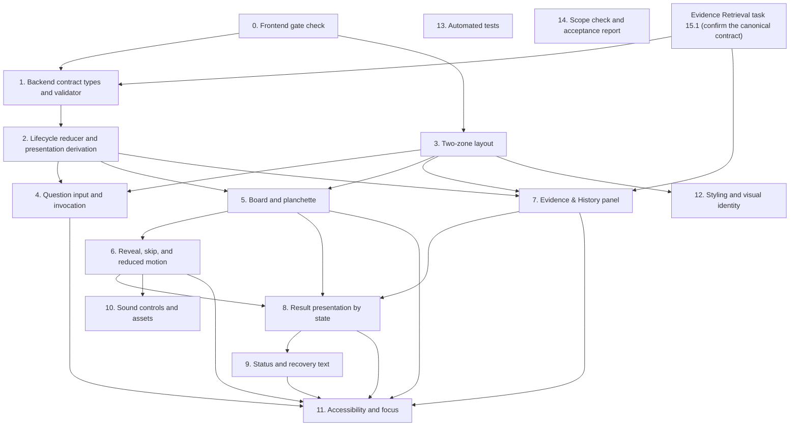

# Implementation Plan: Ouija Experience (Native Spec)

## Overview

This plan turns the Ouija Experience requirements and design into ordered implementation tasks. It has 15 top-level tasks and 45 subtasks (60 checkboxes), and every checkbox is pending. Each task lists the requirements it covers.

**Status: NOT APPROVED. No task may start.** Every task below is pending. These tasks become eligible only after:

1. A human approves `requirements.md` and `design.md`.
2. The implementation gate in Spec 2 §22.6 and Architecture §25 is closed, or the owner explicitly accepts a narrower scope.
3. The task is approved by the owner, as Operating Guide Phase 3 requires for non-trivial work.

Tasks that depend on an open decision (see `design.md`, Open decisions) must not start until that decision is recorded.

## Task Dependency Graph

Execution waves for Kiro's task runner are in the JSON block below. Each entry is a leaf task number: a subtask, or a top-level task that has no subtasks. A wave holds the tasks whose prerequisites are all in earlier waves, and subtasks of one task share their parent's wave because the plan states no dependency between them. Kiro treats every task in a wave as depending on all tasks in earlier waves, so the waves serialize some tasks more than the explicit dependencies require. The explicit dependencies are in the diagram and table after the JSON block. Tasks 1 and 7 also depend on Evidence Retrieval task 15.1, which belongs to another plan's graph and cannot be expressed in this one. See Notes.

```json
{
  "waves": [
    { "id": 0, "tasks": ["0"] },
    { "id": 1, "tasks": ["1.1","1.2","1.3","3.1","3.2","3.3"] },
    { "id": 2, "tasks": ["2.1","2.2","2.3","2.4","12.1","12.2","12.3"] },
    { "id": 3, "tasks": ["4.1","4.2","5.1","5.2","5.3","7.1","7.2","7.3","7.4"] },
    { "id": 4, "tasks": ["6.1","6.2","6.3"] },
    { "id": 5, "tasks": ["8.1","8.2","8.3","8.4","8.5","10.1","10.2","10.3"] },
    { "id": 6, "tasks": ["9.1","9.2"] },
    { "id": 7, "tasks": ["11.1","11.2","11.3"] },
    { "id": 8, "tasks": ["13.1","13.2","13.3"] },
    { "id": 9, "tasks": ["14.1","14.2","14.3","14.4"] }
  ]
}
```

Each edge points from a prerequisite task to the task that depends on it. Edges come only from the dependency text already written in the task headers and subtasks. No dependency is inferred from task numbering or order.



Not drawn: task 13 depends on every task from 1 to 12, and task 14 depends on every task from 0 to 13. The table lists these dependencies.

| Task | Depends on (as written in the task) | Other prerequisites stated in the task |
|---|---|---|
| 0 | none | Spec 2 approval and the Spec 1 gate report (header) |
| 1 | 0; Evidence Retrieval task 15.1 | none stated |
| 2 | 1 | none stated |
| 3 | 0 | none stated |
| 4 | 2, 3 | none stated |
| 5 | 2, 3 | none stated |
| 6 | 5 | none stated |
| 7 | 2, 3; Evidence Retrieval task 15.1 | none stated |
| 8 | 5, 6, 7 | none stated |
| 9 | 8 | none stated |
| 10 | 6 | Asset rules set by O-D7 (header) |
| 11 | 4 to 9 (4, 5, 6, 7, 8, 9) | none stated |
| 12 | 3 | Palette and fonts per O-D4 and O-D8 (header) |
| 13 | 1 to 12 (every task from 1 to 12) | none stated |
| 14 | 0 to 13 (every task from 0 to 13) | none stated |

## Tasks

- [ ] 0. Frontend gate check (depends on: Spec 2 approval, the Spec 1 gate report)
  - Confirm the gates in Spec 2 §22.6 and Architecture §25 that apply to the frontend.
  - Confirm that the decisions O-D1, O-D3, O-D7, and O-D11 are recorded in `design.md`, and that the contract decisions C-D1 to C-D10 are recorded in the Evidence Retrieval design (C-D5 is decided as a UUID version 4 string, and Evidence task 15.1 records that confirmation). O-D2 is resolved by reference to the canonical contract.
  - Report each gate as closed or open. Change no code.
  - _Requirements: Spec 2 §22.6; Architecture §25_

- [ ] 1. Backend contract types and validator (depends on 0 and Evidence Retrieval task 15.1)
  - [ ] 1.1 Define TypeScript types for `InvestigationResult`, `EvidenceRecord`, `Limitation`, and `BackendError` from the canonical contract in `.kiro/specs/evidence-retrieval/design.md`. Do not add fields.
  - [ ] 1.2 Implement `validateResponse`: required fields present, recognized status values only, safe handling of extra fields.
  - [ ] 1.3 Implement `investigationClient` in `services/` to map the result or error into these types. Show no internal details.
  - _Requirements: 23.2, 24.1 to 24.6_

- [ ] 2. Lifecycle reducer and presentation derivation (depends on 1)
  - [ ] 2.1 Implement the `useReducer` state in `features/investigation/` with the lifecycle transitions in `design.md`.
  - [ ] 2.2 Implement `deriveUiState` in the priority order of Spec 2 §8.5. Implement the invalid-combination fallback as decided in O-D1 (`FAILED` presentation with the validation message, canonical C.7).
  - [ ] 2.3 Keep backend values unmodified in state, and keep the derived state separate. Apply a response only when its request token is current (Requirement 6.5).
  - [ ] 2.4 Ignore invocation while a request is in flight (O-D9).
  - _Requirements: 5.2, 6.1 to 6.5, 7.1 to 7.5, 23.1 to 23.3_

- [ ] 3. Two-zone layout (depends on 0)
  - [ ] 3.1 Build `TwoZoneLayout` with a desktop grid, Evidence & History on the left and Ouija Board on the right.
  - [ ] 3.2 Stack the zones vertically on narrow screens (breakpoints per O-D6).
  - [ ] 3.3 Reserve zone dimensions so the concealed state causes no layout shift.
  - _Requirements: 1.1 to 1.4, 2.1 to 2.3_

- [ ] 4. Question input and invocation (depends on 2, 3)
  - [ ] 4.1 Build the question field with validation messages for empty or ambiguous input. Build the explicit repository-relative `target.path` input (O-D11). The question is shown as text only and is never sent as the target.
  - [ ] 4.2 Build the repository selector from the registered repositories (O-D3). Selection sends `repository_id` only. Build the invocation control.
  - _Requirements: 3.1, 3.2, 4.1 to 4.4, 5.1, 5.2_

- [ ] 5. Board and planchette (depends on 2, 3)
  - [ ] 5.1 Build `OuijaBoard` and `Planchette`, driven only by the stage value from the reducer.
  - [ ] 5.2 Implement the stages `REST`, `WAKE`, `SEARCH`, `REVEAL_PREP`, and `SETTLED` with fixed paths (O-D5).
  - [ ] 5.3 Ensure the same lifecycle state always gives the same stage and position.
  - _Requirements: 8.1 to 8.5_

- [ ] 6. Reveal, skip, and reduced motion (depends on 5)
  - [ ] 6.1 Build `ResultReveal` to insert the complete phrase as one text node after `SETTLED`.
  - [ ] 6.2 Implement reduced-motion behavior for each stage, and the skip control.
  - [ ] 6.3 Confirm that skip does not change retrieval, the result, or validation.
  - _Requirements: 9.1 to 9.3, 19.1 to 19.4_

- [ ] 7. Evidence & History panel (depends on 2, 3, and Evidence Retrieval task 15.1)
  - [ ] 7.1 Build evidence cards, empty and concealed states, and the selected-detail view in `EvidenceHistoryPanel`.
  - [ ] 7.2 Show only fields the backend returned. Mark missing fields as unavailable.
  - [ ] 7.3 Build the explanation and timeline with verified and inferred elements visibly distinct.
  - [ ] 7.4 Keep selected evidence across layout changes.
  - _Requirements: 2.1, 14.1 to 14.4, 15.1 to 15.3, 16.1, 16.2, 17.1 to 17.3, 18.1, 18.2_

- [ ] 8. Result presentation by state (depends on 5, 6, 7)
  - [ ] 8.1 Show `COMPLETED` conclusion with its classification (Requirement 10).
  - [ ] 8.2 Show `PARTIAL` narrow conclusion with its limitations (Requirement 11).
  - [ ] 8.3 Show `INSUFFICIENT_EVIDENCE`: neutral phrase, classification, retrieval status, and explanation, with no conclusion (Requirement 12).
  - [ ] 8.4 Show `FAILED` and `CANCELLED` with their own labels and no success reveal (Requirement 13).
  - [ ] 8.5 Show `StatusStrip` with retrieval status and classification as separate labeled values (Requirement 7.3).
  - _Requirements: 7.3, 10.1 to 10.3, 11.1 to 11.3, 12.1 to 12.4, 13.1 to 13.4_

- [ ] 9. Status and recovery text (depends on 8)
  - [ ] 9.1 Add the text for retry, refine question, and inspect evidence, within O-D10.
  - [ ] 9.2 Confirm that no recovery text implies a valid conclusion from a failed operation.
  - _Requirements: 25.1, 25.2_

- [ ] 10. Sound controls and assets (depends on 6; asset rules set by O-D7)
  - [ ] 10.1 Build enable, mute, and volume controls. Default is disabled (Requirement 20.1, 20.2).
  - [ ] 10.2 Attach cues only to the states allowed by Requirement 20.3.
  - [ ] 10.3 Add only original or permissively licensed local assets, each with its source and license recorded in the repository before use (O-D7). Keep the experience complete without audio.
  - _Requirements: 20.1 to 20.5, 26.1, 26.2_

- [ ] 11. Accessibility and focus (depends on 4 to 9)
  - [ ] 11.1 Confirm every essential control is keyboard accessible.
  - [ ] 11.2 Add the polite live region for lifecycle text and check focus behavior across all states.
  - [ ] 11.3 Check contrast and readable type sizes at normal display sizes.
  - _Requirements: 21.1 to 21.5_

- [ ] 12. Styling and visual identity (depends on 3; palette and fonts per O-D4 and O-D8)
  - [ ] 12.1 Apply Tailwind as the primary styling approach and native CSS only where needed (Spec 2 §22.2).
  - [ ] 12.2 Implement the board and planchette animation with CSS and browser APIs only (Requirement 22.1, 22.2).
  - [ ] 12.3 Review visual identity against Spec 2 §5 and record the review (Requirement 27.4).
  - _Requirements: 22.1 to 22.4, 27.1 to 27.4_

- [ ] 13. Automated tests (depends on 1 to 12)
  - [ ] 13.1 Vitest: derivation over all valid status and classification combinations, invalid cases, reducer transitions, validator, and component states.
  - [ ] 13.2 Playwright: two-zone layout at desktop and narrow widths, keyboard-only flow, reveal and skip, evidence selection, and no layout shift.
  - [ ] 13.3 Execute the tests and record the observed results. Do not report any result without execution.
  - _Requirements: 28.1 to 28.3_

- [ ] 14. Scope check and acceptance report (depends on 0 to 13)
  - [ ] 14.1 Confirm no feature from Spec 2 §20.2 was added (Requirement 29.1).
  - [ ] 14.2 Map each Spec 2 §21 criterion to executed evidence. Mark any criterion without evidence as not verified.
  - [ ] 14.3 Produce the Playbook §15 task report for each completed task.
  - [ ] 14.4 Do not mark any task ACCEPTED. Only the owner does that.
  - _Requirements: 29.1, 29.2_

## Notes

Format note: Kiro's documentation describes checkbox tasks in `tasks.md` and a dependency graph built from that file. The exact syntax and how dependency text is recognized are not verified for IDE 1.4.121. The "depends on" text is written for human readers. Do not use "Run all Tasks" before the owner approves this plan.

Status mapping: a `[ ]` checkbox means `NOT_STARTED`. No checkbox is marked complete for `VERIFIED` or `ACCEPTED`. Task status uses the Engineering Playbook §15 vocabulary (`NOT_STARTED`, `IN_PROGRESS`, `BLOCKED`, `IMPLEMENTED`, `VERIFIED`, `ACCEPTED`). Only the owner marks `ACCEPTED`.

### Cross-spec dependency

The contract is defined once, in `.kiro/specs/evidence-retrieval/design.md`, section "Shared integration contract (canonical)". The frontend contract tasks (1 and 7) depend on Evidence Retrieval task 15.1, which approves that contract. Until it is approved, the frontend does not define its types.

Dependency order, which has no cycle:
1. The owner decisions C-D1 to C-D4, C-D6 to C-D10, and E-D1 are recorded in the Evidence Retrieval design. C-D5 (`investigation_id` format) is decided as a UUID version 4 string. Evidence task 15.1 records that confirmation.
2. Evidence Retrieval task 15.1 approves the contract. It depends on no Ouija task.
3. Ouija task 1 defines frontend types and the validator from that contract. Ouija task 7 depends on task 1.
4. Evidence Retrieval task 15.2 implements the route. Ouija integration checks follow.

This plan changes no Evidence Retrieval requirement and no Evidence Retrieval task.
