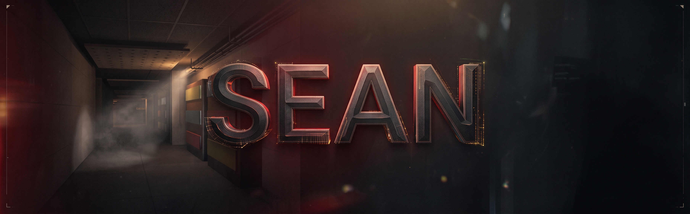
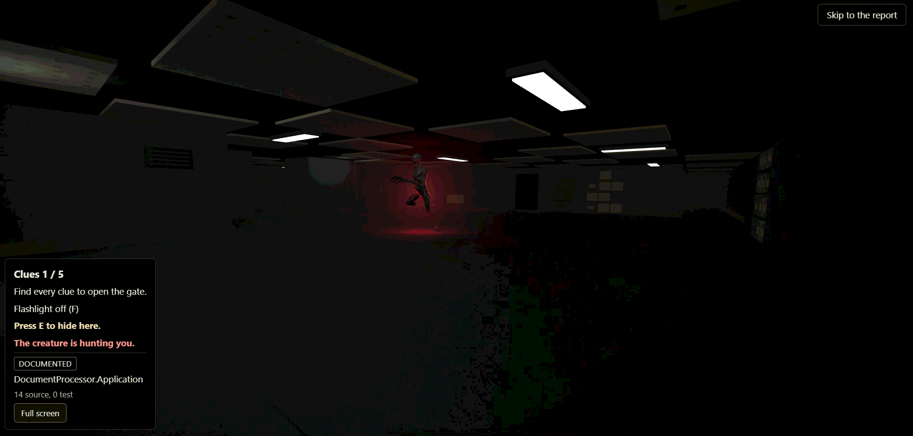

<p align="center">
  
</p>

<h1 align="center">Sean</h1>

<p align="center"><strong>Summon the reasoning behind the code.</strong></p>

<p align="center">
  A local-first repository investigator wrapped in a horror experience: ask why your code is the way it is, then survive the
  archive before the answer is revealed.
</p>

---

## Overview

Sean investigates a Git repository on your own computer and explains why code, mechanisms and decisions exist, using
verifiable evidence: commits, blame, pull requests, issues, documentation and code history. Every finding is labelled as
documented, inferred, partial or insufficient. Sean never presents speculation as historical intent, and it says so when the
evidence is not enough.

While the investigation runs, Sean turns into a horror game. A Ouija board answers first. Then "something else is still in this
repository", and you are dropped into a dark, first-person archive. Collect every clue to open the gate and reach the green
exit while a creature hunts you. Get caught and it gets very close.

The horror is fiction and is labelled as such on screen. It never changes the report, and it can always be skipped.

## Gameplay demo

<p align="center">
  
</p>

## Features

### The investigation
- **Evidence-first answers.** History, blame, pull requests, issues and documentation are retrieved, ranked and classified
  as `DOCUMENTED`, `INFERRED`, `PARTIAL_EVIDENCE` or `INSUFFICIENT_EVIDENCE`. All of this works without any AI provider.
- **A unified report.** It has sections for the repository overview, engineering history, technical findings, evidence and
  transparency (what was and was not seen), and a Kiro Repository Advisor with an implementation roadmap.
- **Optional AI wording.** With a Groq API key, an AI Engineering Advisor section words the answer. Retrieval stays on your
  machine, and the absence or failure of the AI is never a retrieval failure.
- **Repository management in the app.** You add, edit and remove local repositories on the Repositories page, with no
  restart. Saved reports and recent investigations are kept in the sidebar.
- **Read-only by design.** Sean never modifies an investigated repository. Git runs without a shell, with timeouts and
  bounded output.

### The horror experience
- **An Ouija interlude.** The planchette moves with the investigation's state, never at random, and the board remembers your
  question.
- **A first-person 3D game** (Three.js). You play in an institutional archive of filing cabinets, bookshelves, shelving of
  labelled boxes, carts, lockers and flickering fluorescent light.
- **The objective.** Collect every clue (5 in a run) to open the gate, then reach the green exit. Clues can come from your
  latest report, keeping the report's own labels. Clues that are fiction say so.
- **The creature.** A rigged, animated monster patrols, hears running, searches and pursues. You can hide from it in lockers,
  unless it saw you get in.
- **The caught cinematic.** A staged jumpscare (anticipation, acceleration, lunge, impact, hold) ends on a "You were caught"
  card with **Try again** or **Give up and open the report**.
- **Procedural sound.** All audio is synthesised at run time with the Web Audio API. There are no audio files.
- **Settings.**
  - Horror intensity: Gentle, Normal or Intense.
  - Graphics quality: Low, Medium or High.
  - The intense scare can be turned off for a plain capture screen.
  - The game can be skipped while the Ouija still plays.
  - Motion can be reduced.
  - Sound can be turned off.
- **Play the demo.** Settings → Experience → **Play the demo** starts the game with no investigation behind it.

### Controls

| Key | Action |
|---|---|
| `W` `A` `S` `D` | Move |
| Mouse or `←` `→` | Look |
| `Shift` | Run (it hears you) |
| `F` | Flashlight |
| `E` | Hide in a locker, and come out |
| `Esc` | Pause |

## Getting started

Sean is developed and tested on **Windows**. The pinned backend requirements include `pywin32`, so the backend install as
pinned is Windows-only.

### Prerequisites
- Windows 10 or 11 with PowerShell
- [Git](https://git-scm.com/)
- Python 3.14. The backend pins were verified with Python 3.14.10.
- Node.js 24 with npm. Verified with Node 24.13.0 and npm 11.6.2.
- Microsoft Edge, only for the browser tests, which use the installed Edge and download no browser.

### Install

```powershell
git clone https://github.com/EddyDeOleo/Sean.git
cd Sean

# Backend: create the virtual environment and install the pinned packages (runtime and test).
cd backend
python -m venv .venv
.\.venv\Scripts\python.exe -m pip install -r requirements-dev.txt

# Frontend
cd ..\frontend
npm install
```

### Optional configuration

Sean needs no account, key or paid service. Two optional variables are read from the environment or from `.kiro/.env` at the
repository root. That file is ignored by Git and must never be committed.

```dotenv
# Optional: AI-assisted wording of answers (Groq).
SEAN_GROQ_API_KEY=...
# Optional: higher GitHub API limits for public pull request and issue metadata.
SEAN_GITHUB_TOKEN=...
```

Both values are registered for redaction and are never logged. Local data (the repository registry and the backend log) lives
outside the repository, in `%LOCALAPPDATA%\Sean\`.

## Run Sean

Open two terminals.

```powershell
# Terminal 1: the backend API (from backend\)
.\.venv\Scripts\python.exe -m uvicorn app.main_advisor:app --host 127.0.0.1 --port 8000
```

```powershell
# Terminal 2: the frontend dev server (from frontend\)
npm run dev
```

Open <http://127.0.0.1:5173>. The Vite dev server proxies `/api` to the backend. Set `SEAN_BACKEND_URL` to use another
backend address.

1. Go to **Repositories** and add a local Git repository. Give it a name, an identifier, and its folder on this computer.
2. On **New Investigation**, type a request as `identifier — question`, for example `sean — Why does backend/app/main.py exist?`.
3. The Ouija board and the game play while Sean investigates. Use **Skip to the report** at any time.

To play without investigating anything, use **Settings → Experience → Play the demo**.

## Deployment (planned)

Netlify is the planned host. Deployment is **not configured yet**: there is no `netlify.toml` and no deployed site.

What the code supports today:
- **The frontend is a static build.** It builds from `frontend/` with `npm run build` into `frontend/dist`, using Node 24.
  It is one page at `/` with no client-side routes, so it needs no single-page-app redirect rule. The build reads no
  environment variables, and the runtime monster model is served from `/models/`.
- **The game works without the backend.** Play the demo makes no API call. A browser test
  (`e2e/startup-scenarios.spec.ts`) checks that the game still starts, with atmosphere clues, when every backend request
  fails. Investigations, repositories and reports need the backend.
- **The backend is local by design.** It is a Python FastAPI process that runs Git on folders of your own computer. Its
  local-only guard (`backend/app/api/local_guard.py`) refuses any request whose host or origin is not localhost. It is not
  part of a static deployment.

Still to decide and configure:
1. **What the deployed site offers.** It could be the game demo only, which the static frontend supports now, or the full
   investigation, which needs a backend that can be reached from the site.
2. **`netlify.toml`**: base directory `frontend`, build command `npm run build`, publish directory `dist`, and the Node
   version.
3. **For the full investigation:** a hosted backend, plus a `/api/*` rewrite to it. The frontend calls the relative path
   `/api`, and the Vite proxy that serves it exists only in development. Hosting the backend would also need changes that do
   not exist today: the local-only guard, authentication, and access to the repositories to investigate.
4. **Secrets:** `SEAN_GROQ_API_KEY` and `SEAN_GITHUB_TOKEN` are read only by the backend. Never put them in the frontend
   build's environment.

## The horror experience

<p align="center">
  
</p>

The creature hunts by sight and sound. The flashlight makes you easier to see and running makes you easier to hear. A locker
hides you, unless it saw you get in. When it catches you, the camera is pulled into a close-up before the defeat card
appears. The scare respects your settings:
- With the intense scare off, the capture screen is plain.
- Reduced motion replaces the flashing and shaking with a steady dimming.

## Built with Kiro

Sean was built in Kiro IDE (with Kiro CLI as a complement), specification-first and in small, reviewed tasks. Everything below
is in this repository, except the workflows, which are managed by the Kiro IDE.

| Kiro feature | Where | What it does in Sean |
|---|---|---|
| **Specs** | `.kiro/specs/` | Requirements, design and tasks for `evidence-retrieval`, `ouija-experience`, `immersive-experience` and `engineering-intelligence`. The approved source specifications are in `docs/specs/`. |
| **Steering** | `.kiro/steering/` | `architecture.md`, `engineering-standards.md`, `product.md` and `security.md`, each with `inclusion: always`, so they are in every Kiro session. They define the approved stack, the evidence-integrity rules (facts, inferences and insufficient evidence are never merged), testing discipline and repository safety. |
| **Hooks** | `.kiro/hooks/` | `guard-approved-docs`: a `PreToolUse` hook (`guard-approved-docs.json` and `.js`). It asks before an agent edits, moves or deletes a file under `docs/specs/` or `docs/architecture/`, or the Playbook or Operating Guide. It does not see edits made through shell commands, so it is a safeguard, not a security boundary. |
| **Skills** | `.kiro/skills/` | `implement-spec`, `verify-feature`, `review-security` and `verify-game`, each a `SKILL.md` with its own trigger description. |
| **Custom agents** | `.kiro/agents/` | `code-reviewer` (review only; writes need per-action approval, in source and test folders only), `security-auditor` (read and shell tools, no file writes) and `test-engineer` (writes test files only, each with approval). All three load the four steering files, and none may read `.env`, key or certificate files. |
| **KiroIgnore** | `.kiroignore` | Keeps files out of Kiro's agent context: secrets (`.env`, `.env.*` except `.env.example`, `*.pem`, `*.key`, `*.p12`, `*.pfx`, `.git-credentials`), Python environments and caches, `node_modules/`, frontend build and coverage output, Playwright reports and test results, and logs. It limits context; it is not a security boundary. |
| **MCP** | `.kiro/settings/mcp.json` | Runs Sean's own read-only MCP server (`python -m app.modules.mcp`, STDIO), with the tools `search_history`, `blame_range`, `get_pr` and `get_issue`. They call the same backend logic as the HTTP API. The file holds absolute paths for the author's machine, so adjust them to your clone. |
| **Reports** | `.kiro/reports/` | Phase status and workstream reports: what was changed, what was verified, and what is still open. |
| **Workflows** | Kiro IDE, Workflows sidebar (not stored in this repository) | Used to run parallel workstreams. Three completed runs of the `agent-wf-coder` workflow, each a single step by the `wf-coder` agent, built Workstream B (startup that does not depend on the investigation), C (the caught cinematic) and D (the archive). Each was limited to its own files; see the ownership table in `.kiro/reports/workstreams.md` and the summaries in `.kiro/reports/ws-b-startup.md`, `ws-c-cinematic.md` and `ws-d-archive.md`. |

The engineering process itself is documented in the [Kiro Engineering Playbook](docs/development/kiro-engineering-playbook.md)
and the [Kiro Operating Guide](docs/development/kiro-operating-guide.md).

## Testing and quality assurance

| Suite | Command | Validates |
|---|---|---|
| Backend | `.\.venv\Scripts\python.exe -m pytest` (from `backend\`) | Unit and integration tests: repository safety, Git retrieval, ranking, classification, redaction, the HTTP API and the MCP tools |
| Frontend unit and component | `npm test` (from `frontend\`) | Vitest: the investigation state machine, report validation, audio, game rules, game balance across difficulties, archive layout and collision, and the cinematic |
| Type check | `npm run typecheck` | TypeScript across the frontend |
| Production build | `npm run build` | Type check plus a Vite production build |
| Browser end to end | `npm run test:e2e` | Playwright against a real Vite server and a fixture backend on disposable repositories. Covers the journey, startup, game, horror, escape, cinematic and archive checks. |
| Audio in the browser | `npx playwright test -c playwright.audio.config.ts` | Browser audio behaviour |

Visual QA evidence (inspected screenshots from the game, the cinematic and the archive) is kept in
`frontend/evidence/visual-qa/`, with an index in [`visual-qa-report.md`](frontend/evidence/visual-qa/visual-qa-report.md).

### Known open item: the escape acceptance gate

`frontend/e2e/escape-deterministic.spec.ts` plays seeds **1, 2 and 3** with a scripted player and requires each to escape on
its first attempt. On the current build:

| Seed | First attempt | Result |
|---|---|---|
| 1 | Caught at 66.55 s (escapes on a retry) | **Fails** |
| 2 | Caught at 47.88 s (escapes on a retry) | **Fails** |
| 3 | Escaped at 148.93 s | Passes |

The cause is the archive furniture's collision, which changes the scripted player's route. Seed 1 has failed since the
furniture became solid, and seed 2 since the decoration was restored. Across seeds 1 to 40, first-attempt escapes are within
sampling noise of the layout without furniture collision, and the 400-game balance suite passes. The gate is recorded as
unresolved and has not been redefined to pass. `frontend/e2e/archive-states.spec.ts` is an older archive fixture that is also
known to fail. `archive-qa.spec.ts` replaces it, and it is kept pending a decision.

## Project structure

```text
Sean/
├── assets/monster/           monster source models (not loaded at runtime); see its README
│   ├── source/               original model and the three rigged animation inputs
│   └── variants/             optional benchmark variants (local only, not in Git)
├── backend/                  FastAPI backend (Python)
│   ├── app/
│   │   ├── api/              HTTP routes, local-only guard
│   │   ├── core/             configuration, safe Git runner, limits, redaction
│   │   ├── modules/          repository, git_history, github, evidence, investigation,
│   │   │                     explanation, answer, advisor, intent, repository_profile, mcp
│   │   ├── main.py           Phase 3 API entry point
│   │   └── main_advisor.py   full application entry point (used by Sean)
│   ├── tests/                unit and integration tests
│   └── requirements*.txt     pinned dependencies
├── frontend/                 React + TypeScript + Vite frontend
│   ├── src/
│   │   ├── app/              application shell
│   │   ├── components/       report, request, shell, game, interlude and Ouija components
│   │   ├── dev/              development-only monster validation page and model-variant serving
│   │   └── features/         analysis, audio, interlude, report, investigation, game (world rules,
│   │                         renderer, archive, monster animation, cinematic)
│   ├── public/models/        the runtime monster model, the only model the game loads (glTF)
│   ├── tests/                Vitest suites
│   ├── e2e/                  Playwright suites and the deterministic game driver
│   └── evidence/visual-qa/   inspected visual QA evidence
├── scripts/                  backend start, fixture repositories, diagnostics, monster rigging tools
├── docs/
│   ├── specs/                approved specifications (Specs 1 to 4)
│   ├── architecture/         architecture and project setup
│   ├── development/          playbook, operating guide, decision records
│   └── media/                README banner and GIFs
└── .kiro/                    specs, steering, hooks, skills, agents, MCP settings and reports
```

## Technology stack

| Area | Technologies |
|---|---|
| Frontend | React 19, TypeScript 6, Vite 8, Tailwind CSS 4, Three.js 0.187 |
| Audio | Web Audio API (procedural synthesis) |
| Backend | Python 3.14, FastAPI, Pydantic, Uvicorn |
| History and metadata | Git CLI, GitHub REST API (public pull request and issue metadata) |
| Integrations | Official Python MCP SDK (read-only STDIO server), optional Groq API for AI wording |
| Testing | pytest, Vitest, Playwright (Microsoft Edge), jsdom, fake-indexeddb |
| Development | Kiro IDE and Kiro CLI |

## Documentation

- [Spec 1: Evidence Retrieval](docs/specs/spec-1-evidence-retrieval.md)
- [Spec 2: Ouija Experience](docs/specs/spec-2-ouija-experience.md)
- [Spec 3: Immersive Experience](docs/specs/spec-3-immersive-experience.md)
- [Spec 4: Engineering Intelligence](docs/specs/spec-4-engineering-intelligence.md)
- [Architecture and Project Setup](docs/architecture/architecture-and-project-setup.md)
- [Audio asset manifest](docs/development/audio-asset-manifest.md)

## Credits and license

Created by Eddy Yail De Oleo Arias for the Kiro Hackathon, and built with [Kiro](https://kiro.dev).

Released under the [MIT License](LICENSE).

## Links

- Repository: <https://github.com/EddyDeOleo/Sean>
